<Badge>Proprietary agent harness</Badge> <Badge>Checked before and after every reply</Badge> <Badge>Stops when your team takes over</Badge>

## **What runs behind every Myna agent?**

Every Myna agent runs inside the **Myna Runtime**, the **harness** that sits between your customers and the AI model. 

A Myna runtime has two main components that work together:

- **The AI model:** the part that understands language. It reads what your customer writes, works out what they need, decides which actions to take and writes the reply.
- **The control layer:** the software built around the model. It checks every message before the model sees it, gives the model only the information it needs, runs the tools that carry out actions, and checks every reply before it reaches your customer.

This runtime is built into every agent and works the same way on every channel, whether a message arrives by SMS, WhatsApp, email or webchat. There is nothing to install or set up.

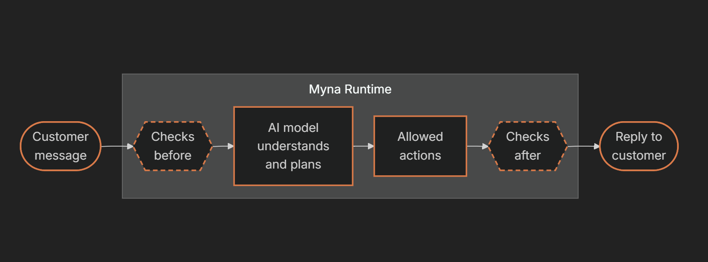

<Info>
  The AI model never works on its own. The control layer decides when it runs, what it sees and what happens to its answers, and enforces your rules exactly, every time.
</Info>

<Tip>
  **No prompt writing needed to create a Myna agent!** A prompt is the block of written instructions an AI model reads before it answers. In Myna you never write one yourself. You describe the job in plain words, choose a persona and switch on tools in Workflow Studio, and the runtime turns those choices into the right instructions for each step.
</Tip>

## **Why not just write one big prompt?**

Many AI agents are built on a single long prompt that holds everything at once: the personality, the business rules, the tool instructions, the prices and the formatting. But with this strategy as a business adds rules and edge cases, the prompt keeps growing, and problems start to show.

<Columns cols={2}>
  <Column>
    <Card title="**Rules collide**" icon="code-merge">
      Instructions like “keep replies short” and “explain every service in detail” can sit side by side, and the model decides which one wins.
    </Card>

    <Card title="**Stronger wording doesn't fix anything**" icon="bullhorn">
      Writing a rule in capital letters doesn't guarantee the model follows it. It is still one instruction weighed against hundreds of others.                                                                                                                                      
    </Card>
  </Column>
  <Column>
    <Card title="**Critical rules get buried**" icon="layer-group">
      A rule such as never confirming a booking before it happens sits in the same text as a rule about emoji, and to the model, both are just lines of text with the same weight.
    </Card>

    <Card title="**Mistakes are hard to trace**" icon="bulldozer">
      When everything lives in one document, it's hard to tell whether a problem came from the instructions, the knowledge or a conflicting rule. The usual fix is one more sentence.                                                          
    </Card>
  </Column>
</Columns>

Myna splits that work apart. Your agent’s setup is kept in separate modules for instructions, persona, tool rules and knowledge. The rules that must always hold are written into the software itself, outside the prompt. 

<table>
  <colgroup>
    <col width="333" />
    <col width="396" />
  </colgroup>
  <thead>
    <tr>
      <th>**Instead of**</th>
      <th>**Myna does this**</th>
    </tr>
  </thead>
  <tbody>
    <tr>
      <td>**One long prompt that holds everything**</td>
      <td>Keeps instructions, persona, tool rules and knowledge as separate modules, each used only where it is needed</td>
    </tr>
    <tr>
      <td>**Hoping the AI remembers a rule**</td>
      <td>Enforces the rule in code, so it applies every single time</td>
    </tr>
    <tr>
      <td>**Letting the AI act and write in one go**</td>
      <td>Does the work first, then writes the reply from what actually happened</td>
    </tr>
  </tbody>
</table>

<Info>
  **The principle behind the runtime:** use a model for judgment and language, and software for anything that requires certainty.
</Info>

## **Follow one message through the runtime**

Every message your agent receives goes through the same eight stages, in the same order. Here is the whole journey at a glance, followed by a closer look at each stage.

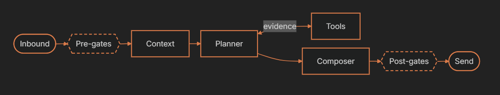

<Steps>
  <Step title="**Inbound (a message arrives)**">
    A customer sends a message on any connected channel. The runtime records who sent it, what they wrote and which channel it came through, so every stage after this one starts from the same facts.

    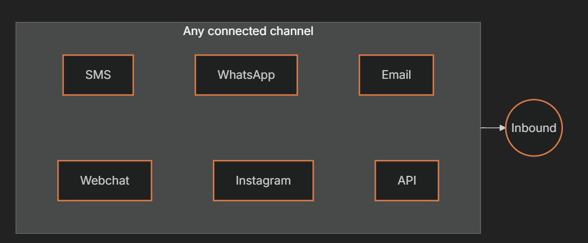
  </Step>
  <Step title="Pre-Gates (**checking the message before any model runs)**">
    Before any AI model runs, the runtime checks the message against a set of rules written in code. If a check fails, the message is blocked or deferred, and no model is involved at all.

    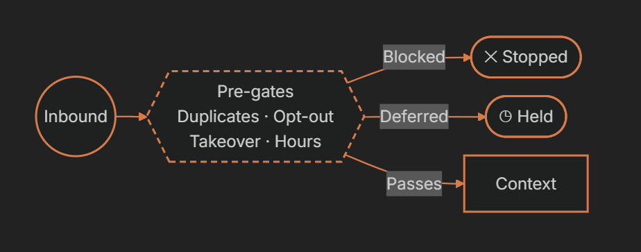

    These checks cover common situations that can be handled automatically:

    <table>
      <colgroup>
        <col width="162" />
        <col width="497" />
      </colgroup>
      <thead>
        <tr>
          <th>**Check**</th>
          <th>**What it catches**</th>
        </tr>
      </thead>
      <tbody>
        <tr>
          <td>**Duplicates**</td>
          <td>The same message arriving more than once</td>
        </tr>
        <tr>
          <td>**Opt-outs**</td>
          <td>Contacts who have asked not to be messaged</td>
        </tr>
        <tr>
          <td>**Takeover**</td>
          <td>Conversations a teammate has taken over</td>
        </tr>
        <tr>
          <td>**Channel compliance**</td>
          <td>Rules that apply to the channel the message came from</td>
        </tr>
        <tr>
          <td>**Message caps**</td>
          <td>Limits on how many messages can be sent</td>
        </tr>
        <tr>
          <td>**Business hours**</td>
          <td>Times when your agent isn't allowed to reply</td>
        </tr>
      </tbody>
    </table>

    <Info>
      Because these checks are code, they behave the same way every time. An opt-out is enforced by the software itself, so it never depends on the model remembering a rule.
    </Info>
  </Step>
  <Step title="**Context (assembled in modules)**">
    Your data is never merged into one giant block. Myna keeps them as separate modules, and each stage reads only the modules it needs. The composer, for example, uses your persona to write in the right voice and the channel policy to get the length right.

    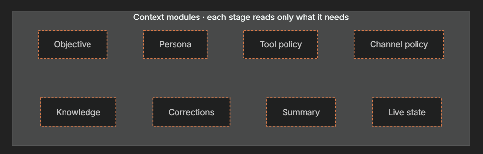

    <table>
      <colgroup>
        <col width="124" />
        <col width="533" />
      </colgroup>
      <thead>
        <tr>
          <th>**Module**</th>
          <th>**What it holds**</th>
        </tr>
      </thead>
      <tbody>
        <tr>
          <td>**Objective**</td>
          <td>What the agent is trying to achieve, from your instructions</td>
        </tr>
        <tr>
          <td>**Persona**</td>
          <td>The voice and personality the agent writes in</td>
        </tr>
        <tr>
          <td>**Tool policy**</td>
          <td>The rules for when and how each tool may be used</td>
        </tr>
        <tr>
          <td>**Channel policy**</td>
          <td>How replies should look on each channel, such as length and layout</td>
        </tr>
        <tr>
          <td>**Knowledge**</td>
          <td>Relevant information retrieved from Memory Hub</td>
        </tr>
        <tr>
          <td>**Corrections**</td>
          <td>Feedback you have reviewed and approved in the Playground</td>
        </tr>
        <tr>
          <td>**Summary**</td>
          <td>A summary of the conversation so far</td>
        </tr>
        <tr>
          <td>**Live state**</td>
          <td>The contact's current fields, answers, appointments and tickets</td>
        </tr>
      </tbody>
    </table>
  </Step>
  <Step title="Planner (**reasons, then calls its tools)**">
    The planner is the part of the agent that thinks. It reads the context, works out what the customer needs and calls tools by name. After each tool returns, it reads the result and decides what to do next. It repeats this for a few steps at most, and it never writes a single word the customer sees.

    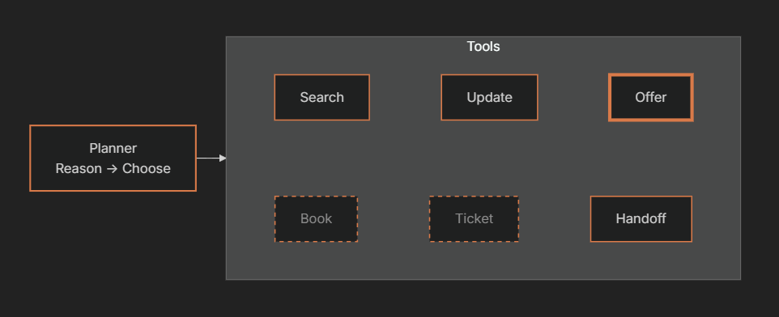

    At any moment, each tool is in one of three states. In the diagram, the thick border is the tool being picked, solid borders are available tools, and dashed grey borders are tools that aren't open yet.

    <table>
      <colgroup>
        <col width="100" />
        <col width="588" />
      </colgroup>
      <thead>
        <tr>
          <th>**State**</th>
          <th>**What it means**</th>
        </tr>
      </thead>
      <tbody>
        <tr>
          <td>**Picked**</td>
          <td>The planner has chosen this tool for the current step</td>
        </tr>
        <tr>
          <td>**Available**</td>
          <td>The tool is enabled and can be used right now</td>
        </tr>
        <tr>
          <td>**Not yet**</td>
          <td>The tool isn't open at this point in the conversation. For example, the Schedule Appointments engine keeps booking locked until every required question is answered</td>
        </tr>
      </tbody>
    </table>
  </Step>
  <Step title="Tool Evidence (t**ools return evidence)**">
    When the planner calls a tool, the tool fills in its own inputs from the conversation and the contact record, runs, and returns structured output. That output is evidence of what actually happened, not a message for the customer. It goes back to the planner for its next decision, and on to the composer.

    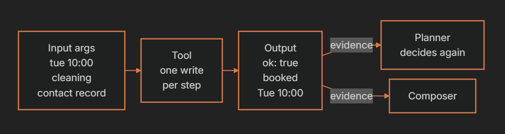

    Here is the same booking as data:

    ```json
    Input · what the tool filled in
    {
      "time": "tue 10:00",
      "calendar": "cleaning",
      "contact": "from record"
    }
    Evidence · what the tool returned
    {
      "ok": true,
      "outcome": "booked",
      "summary": "Tue 10:00"
    }
    ```

    <Info>
      Tools that change data, such as booking an appointment or updating a contact, are treated as critical. Only one of them can run per step, and if a call has already succeeded, running it again returns the first result instead of booking twice.
    </Info>
  </Step>
  <Step title="Composer (**writes the reply)**">
    Once the planner is done, a single composer writes the reply, using confirmed evidence only. Its voice comes from your persona, set with the persona sliders or learned by the Emulator from real messages. Its length and layout come from the channel policy, so the same answer can be a short text on SMS and a fuller message by email.

    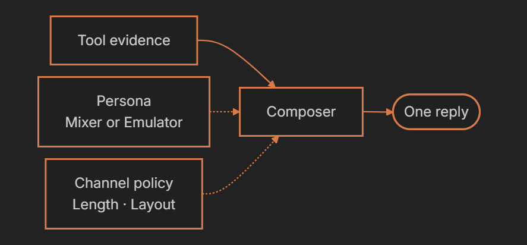
  </Step>
  <Step title="Post-Gates ( before anything gets sent)">
    Before anything is sent, a second set of checks written in code compares every claim in the reply with the tool evidence. They catch replies that claim something no tool proved, and replies that would reveal the agent's internal instructions. A reply that fails gets one repair pass. If it still fails, the runtime sends a safe line instead.

    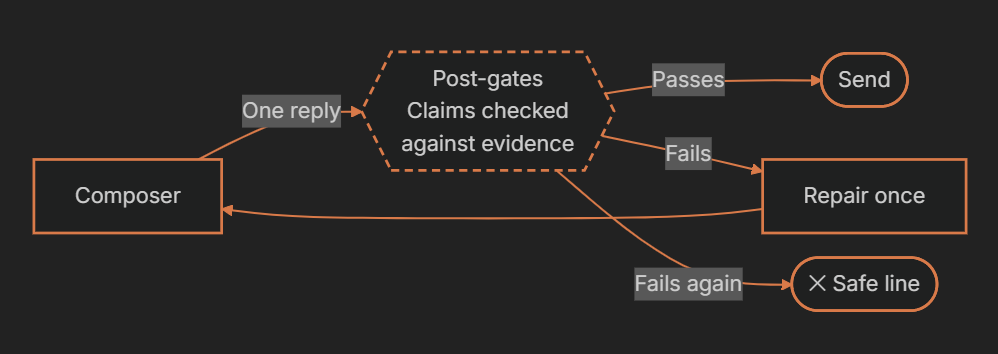

    | **The reply says** | **The evidence shows** | **What happens** |
    | :-- | :-- | :-- |
    | **You're booked for Tuesday at 10:00.** | outcome: booked | The reply is sent |
    | **You're booked for Tuesday at 10:00.** | The booking failed | The reply is repaired, or replaced with a safe line |
    | **Text that repeats the agent's internal instructions** | Not applicable | Caught as prompt leakage before it reaches the customer |
  </Step>
  <Step title="Send (sends the message then land)">
    Only the runtime sends messages, and only after the post-gates approve. In a workflow with more than one agent node, the contact then lands on the right next step. Routing uses deterministic conditions, and the workflow graph is verified so it can always run.

    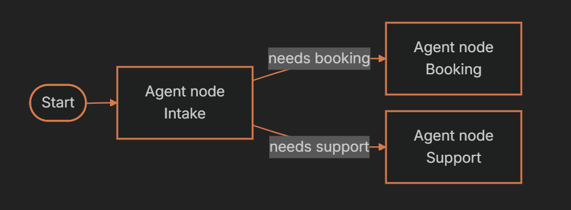

    <Info>
      Every turn is fully traced. When you test an agent, the logs show the plan, the tool calls and the checks behind each reply.
    </Info>
  </Step>
</Steps>

## **What the runtime promises**

These eight rules hold on every turn, on every channel, for every agent.<br />

<Columns cols={2}>
  <Column>
    <Card title="T**ools never send**" icon="send">
      Only the runtime sends messages, and only after the post-gates approve. A tool built to send messages can't even be registered.
    </Card>

    <Card title="**One change per step**" icon="list-1-2">
      At most one tool that changes data runs per step, and a call that already succeeded returns its result instead of running twice.
    </Card>

    <Card title="**A bounded loop**" icon="person-walking-arrow-loop-left">
      Planning runs for a small, capped number of steps. Any tool failure ends it, and the customer still gets an honest reply.
    </Card>

    <Card title="**A fixed order of priority**" icon="arrow-down-wide-short">
      Safety comes first, then truth and your instructions, then the channel, then the persona's voice.
    </Card>
  </Column>
  <Column>
    <Card title="**Tools can be removed**" icon="filter">
      Each layer can only narrow the tools on offer. A tool that isn't enabled for the current turn is refused, even one that only reads data.
    </Card>

    <Card title="**No false confirmations**" icon="xmark-circle">
      A failed booking, move or handoff can never be reported as done. A reply can only claim what a tool proved.
    </Card>

    <Card title="**Takeover means silence**" icon="hand-holding-hand">
      When someone on your team takes over, the agent stops before any model runs. Incoming messages still reach your team.
    </Card>

    <Card title="**Facts come from records**" icon="database">
      Contact fields, answers, appointments and tickets are read from structured records every turn, not remembered from the transcript.
    </Card>
  </Column>
</Columns>

## **What wins when rules conflict?**

Every rule in the runtime has a rank, and a higher rank always wins.

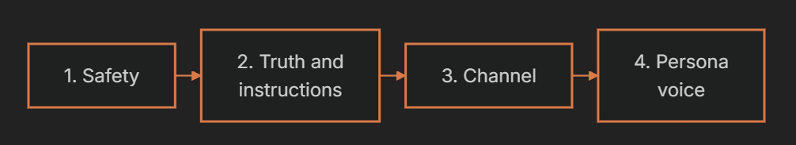

If staying in your persona's playful voice would mean bending a fact, the fact wins. If a channel needs a shorter reply than your persona likes to write, the channel wins. Corrections you approve in the Playground can change how your agent words things, but never the facts it states.

## **What does this look like in practice?**

Here is how a Myna agent handles the situations that most often go wrong with AI agents.

<table>
  <colgroup>
    <col width="313" />
    <col width="388" />
  </colgroup>
  <thead>
    <tr>
      <th>**When this happens**</th>
      <th>**What the runtime does**</th>
    </tr>
  </thead>
  <tbody>
    <tr>
      <td>**A customer opts out**</td>
      <td>The opt-out check stops the agent before any model runs</td>
    </tr>
    <tr>
      <td>**A teammate takes over a conversation**</td>
      <td>The agent goes silent, and new messages go straight to your team</td>
    </tr>
    <tr>
      <td>**The same message arrives twice**</td>
      <td>The duplicate check stops the second copy</td>
    </tr>
    <tr>
      <td>**A message comes in outside your reply hours**</td>
      <td>The business hours check keeps the agent from replying</td>
    </tr>
    <tr>
      <td>**A booking fails**</td>
      <td>The agent can't say the customer is booked, and still sends an honest reply</td>
    </tr>
    <tr>
      <td>**The same booking is requested twice**</td>
      <td>The second call returns the first result instead of creating a duplicate</td>
    </tr>
    <tr>
      <td>**The planner reaches for a tool you didn't enable**</td>
      <td>The runtime refuses the call</td>
    </tr>
  </tbody>
</table>

<br /><br /><br />
