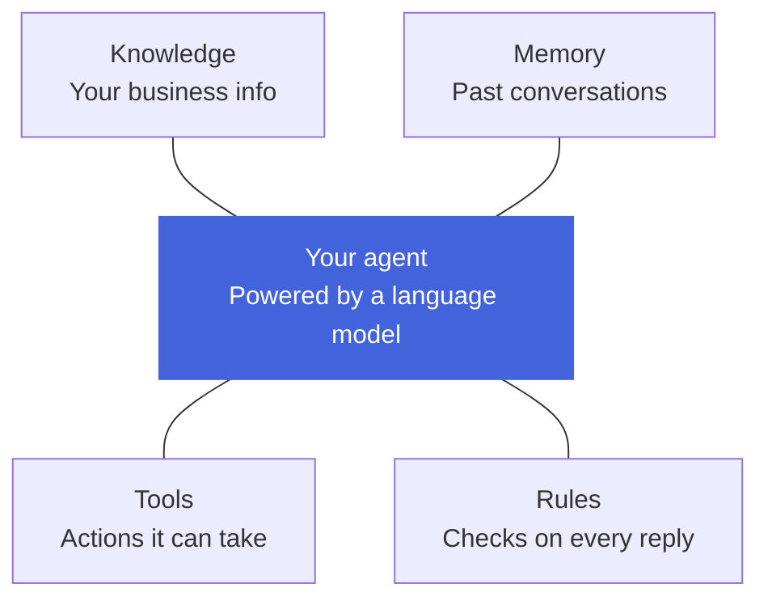

What an AI agent is, how it differs from a language model on its own, and the tools a Myna agent can use.

## **What is an AI agent?**

An AI agent is a program that can hold a conversation and act on it. It reads what a person writes, works out what needs to happen, uses the tools it has been given to do that work, and then replies with the result.

