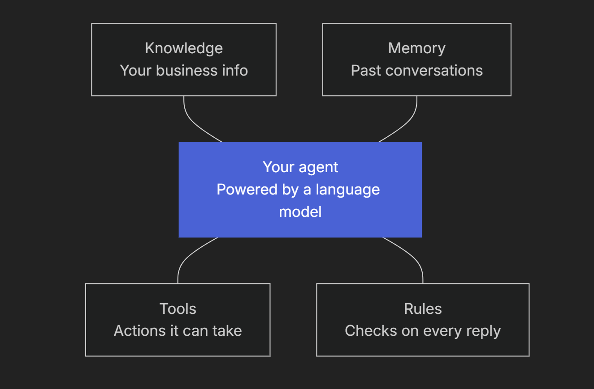
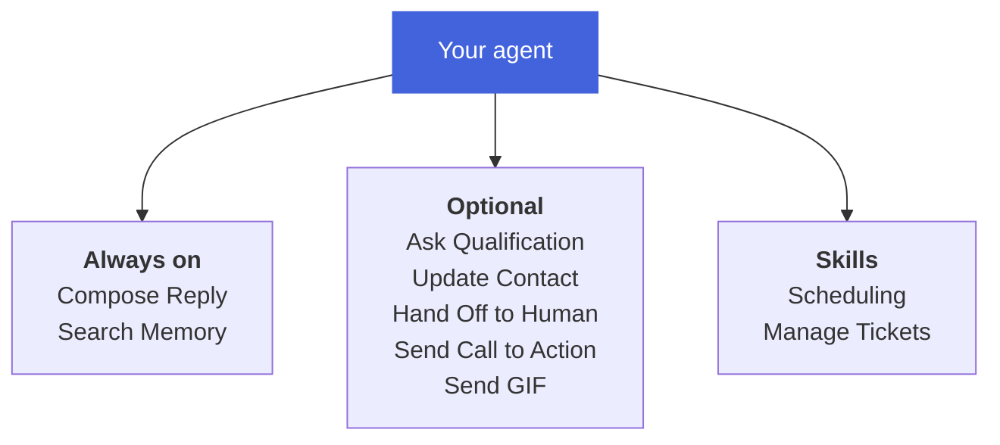

What an AI agent is, how it differs from a language model on its own, and the tools a Myna agent can use.

## **What is an AI agent?**

An AI agent is a program that can hold a conversation and act on it. It reads what a person writes, works out what needs to happen, uses the tools it has been given to do that work, and then replies with the result.

At the center of every agent is a large language model, the same kind of technology behind tools like ChatGPT. The model is what lets an agent understand everyday language, including typos, slang and half-finished sentences. Everything built around the model, such as its tools, its knowledge and its rules, is what turns it into an agent that can do a job.

## **Isn't that just ChatGPT?**

Not quite. A simple language model on its own is very good at writing text, but it was never built to run part of your business. 

A Myna agent uses the model to understand the customer, then uses its tools to finish the job itself. The table below shows where the two differ:

<table>
  <colgroup>
    <col width="130" />
    <col width="247" />
    <col width="313" />
  </colgroup>
  <thead>
    <tr>
      <th></th>
      <th>**A language model on its own**</th>
      <th>**A Myna agent**</th>
    </tr>
  </thead>
  <tbody>
    <tr>
      <td>**What it knows**</td>
      <td>What it learned during training, which doesn't include your prices, policies or opening hours</td>
      <td>Your business, from your business profile and the knowledge you add to Memory Hub</td>
    </tr>
    <tr>
      <td>**What it can do**</td>
      <td>Write a reply</td>
      <td>Book and change appointments, update contact records, create tickets and hand conversations to your team</td>
    </tr>
    <tr>
      <td>**What it remembers**</td>
      <td>Only the chat in front of it</td>
      <td>Each contact's saved details and a summary of earlier conversations with them</td>
    </tr>
    <tr>
      <td>**Date and time**</td>
      <td>No reliable sense of today's date or the time</td>
      <td>Works with the current date, time and your timezone</td>
    </tr>
    <tr>
      <td>**Following rules**</td>
      <td>Tries to follow instructions written in a prompt</td>
      <td>Rules such as opt-outs and quiet hours are enforced by the platform before the model runs</td>
    </tr>
    <tr>
      <td>**Accuracy**</td>
      <td>Can state things that aren't true with full confidence</td>
      <td>Only confirms actions that actually happened, and its replies are checked before they're sent</td>
    </tr>
    <tr>
      <td>**Where it works**</td>
      <td>In a chat window</td>
      <td>On SMS, WhatsApp, webchat and email</td>
    </tr>
  </tbody>
</table>

## **What happens when a customer writes in?**

Every message goes through the same cycle. Here is what happens when a customer texts `"Can I move my appointment to Friday?"`

<Steps>
  <Step title="**Understand**">
    The agent reads the message together with what it already knows: the customer's contact record, a summary of earlier conversations, the current date and time, and your instructions.
  </Step>

  <Step title="**Decide**">
    It works out that the customer wants to change an existing appointment, and picks the scheduling tools needed to do that.
  </Step>

  <Step title="**Act**">
    It finds open times and moves the appointment once the customer chooses one.
  </Step>

  <Step title="**Reply**">
    Only after the tools have returned their results does the agent write its reply, in your persona's voice. If the change didn't go through, it won't tell the customer that it did.
  </Step>
</Steps>

To see how Myna keeps this cycle reliable, read <u>Why Myna Agents Are Different</u>.

## **Which tools can an agent use?**

Tools are the actions an agent is allowed to take, and they decide how much an agent can really get done. An agent connected to your calendar can book appointments, while one without that tool can only talk about them. The better the tools, the more capable the agent.

Myna gives you a suite of built-in tools, and you switch on the ones each agent needs in Workflow Studio. Every tool is built to run safely with real customers. Before it acts, it checks that it has everything it needs, such as a confirmed time before booking an appointment. If something still goes wrong, your agent never tells the customer that the action went through.

Every agent comes with nine **system tools**. Two are always on, two are **skills** that bundle several related tools together, and you can switch the rest on or off for each agent. Select the pencil icon next to a tool to edit it.

Here is what each tool is meant for:

<table>
  <colgroup>
    <col width="214" />
    <col width="389" />
    <col width="100" />
  </colgroup>
  <thead>
    <tr>
      <th>**System tool**</th>
      <th>**What it does**</th>
      <th>**Type**</th>
    </tr>
  </thead>
  <tbody>
    <tr>
      <td>**Compose Reply**</td>
      <td>Writes every message the agent sends</td>
      <td>**Always on**</td>
    </tr>
    <tr>
      <td>**Search Memory**</td>
      <td>Looks up information in Memory Hub when the conversation needs it</td>
      <td>**Always on**</td>
    </tr>
    <tr>
      <td>**Ask Qualification**</td>
      <td>Asks the next required question you've set up</td>
      <td>**Optional**</td>
    </tr>
    <tr>
      <td>**Update Contact**</td>
      <td>Saves the customer's details and answers to their contact record</td>
      <td>**Optional**</td>
    </tr>
    <tr>
      <td>**Scheduling**</td>
      <td>Offers available times, books appointments and changes existing ones</td>
      <td>**Skill**</td>
    </tr>
    <tr>
      <td>**Manage Tickets**</td>
      <td>Creates and updates support tickets</td>
      <td>**Skill**</td>
    </tr>
    <tr>
      <td>**Hand Off to Human**</td>
      <td>Passes the conversation to someone on your team</td>
      <td>**Optional**</td>
    </tr>
    <tr>
      <td>**Send Call to Action**</td>
      <td>Sends a call to action you've set up, prompting the customer's next step</td>
      <td>**Optional**</td>
    </tr>
    <tr>
      <td>**Send GIF**</td>
      <td>Sends a GIF to add some personality to the conversation</td>
      <td>**Optional**</td>
    </tr>
  </tbody>
</table>

<Info>
  An agent can only act through the tools you've switched on, and it can only see the contact fields you've made visible to it. If a tool is off, the agent can't take that action, whatever the customer asks.
</Info>

<Note>
  **Custom tools are coming soon.** You'll be able to connect webhooks, MCP tools and custom integrations to give your agents new abilities. To get early access, select **Request access** under Custom tools in your agent's tool settings.
</Note>

## **Does one agent do everything?**

Today, each agent runs as a single **Agent Node**: one set of instructions working with the tools you select. That single agent can cover a lot in one conversation, such as answering a question, collecting the details you need and booking the appointment.

Multi-step workflows, where a conversation moves between steps that each have their own instructions and tools, are available on request.

<Tip>
  Only switch on the tools your agent's job needs. A booking agent rarely needs Manage Tickets, and fewer tools make its behavior easier to predict and test.
</Tip>
