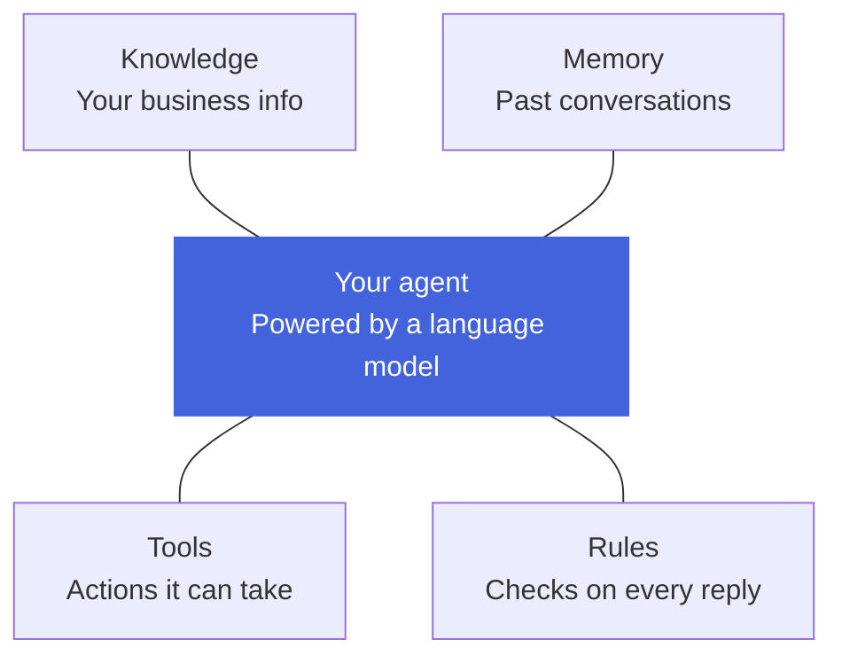
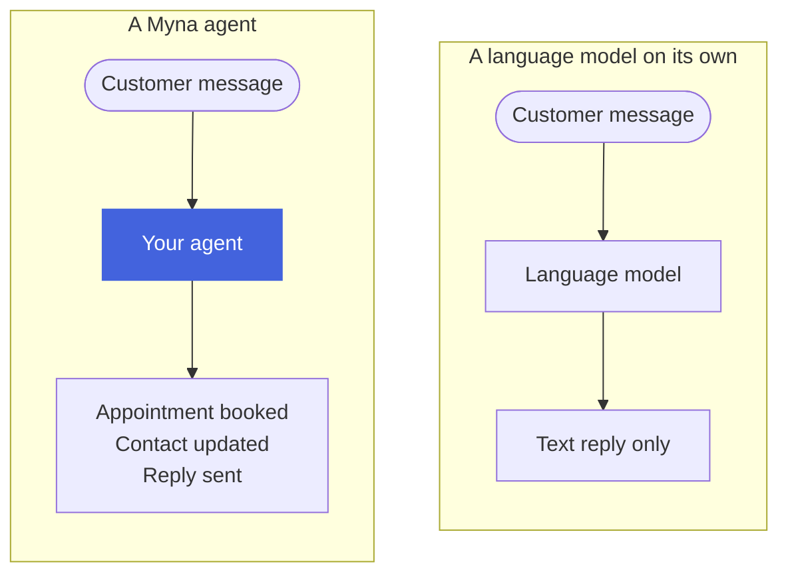

What an AI agent is, how it differs from a language model on its own, and the tools a Myna agent can use.

## **What is an AI agent?**

An AI agent is a program that can hold a conversation and act on it. It reads what a person writes, works out what needs to happen, uses the tools it has been given to do that work, and then replies with the result.

At the center of every agent is a large language model, the same kind of technology behind tools like ChatGPT. The model is what lets an agent understand everyday language, including typos, slang and half-finished sentences. Everything built around the model, such as its tools, its knowledge and its rules, is what turns it into an agent that can do a job.

## **Isn't that just ChatGPT?**

Not quite. A language model on its own is very good at writing text, but it was never built to run part of your business. 

A Myna agent uses the model to understand the customer, then uses its tools to finish the job itself. The table below shows where the two differ:

   
