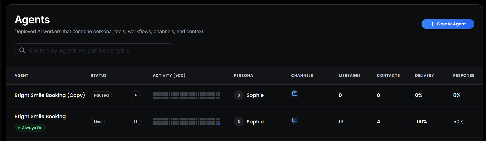
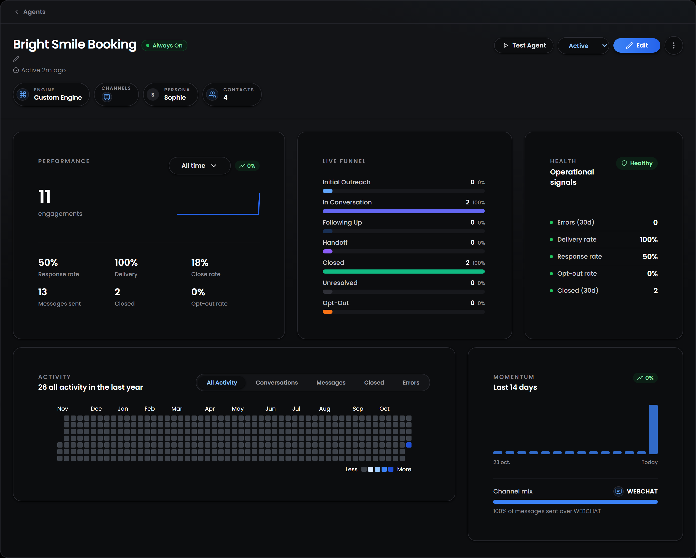
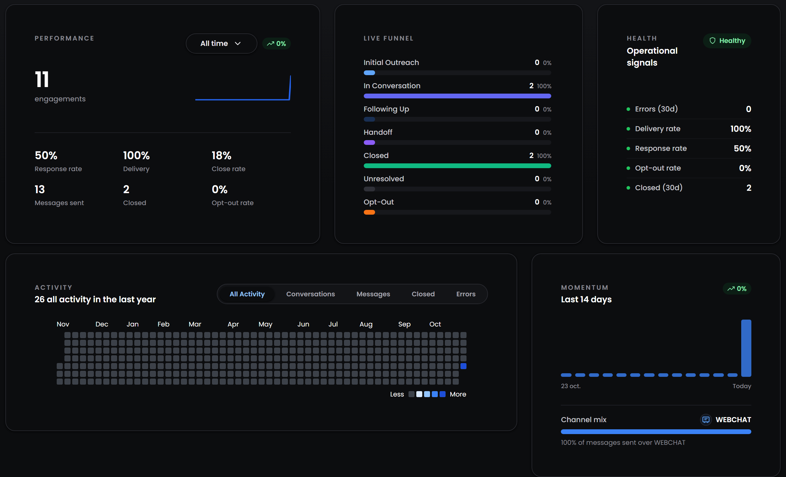
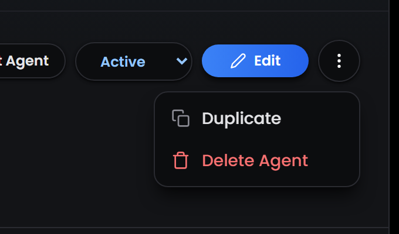

---
title: "Agents"
---

<Badge>Every agent in one place</Badge> <Badge>Pause and resume in a click</Badge> <Badge>Track how each agent performs</Badge>

## **What is the Agents page?**

The Agents page is where you manage every agent in your workspace once it's built. From here you can see which agents are live, pause one, open an agent to check how it's performing, and copy or delete agents you no longer need. 

Building an agent, from instructions and tools to publishing it, is covered step by step in [Launch your first agent](/platform/getting-started/launch-your-first-agent). This page covers what comes after. 

## **What does the agent list show?**

Each row is one agent. Use the search bar to find an agent by its name, its persona or its engine, and select a row to open the agent. 

<table>
  <colgroup>
    <col width="150" />
    <col width="550" />
  </colgroup>
  <thead>
    <tr>
      <th>**Column**</th>
      <th>**What it shows**</th>
    </tr>
  </thead>
  <tbody>
    <tr>
      <td>**Agent**</td>
      <td>The agent's name and, once it's live, its availability badge</td>
    </tr>
    <tr>
      <td>**Status**</td>
      <td>**Draft**, **Live** or **Paused**, explained below, with the <Icon icon="pause" /> pause and <Icon icon="play" /> resume button next to it</td>
    </tr>
    <tr>
      <td>**Activity (90d)**</td>
      <td>A small grid of the agent's daily activity over the last 90 days</td>
    </tr>
    <tr>
      <td>**Persona**</td>
      <td>The persona the agent speaks with</td>
    </tr>
    <tr>
      <td>**Channels**</td>
      <td>The channels the agent talks to customers on. Hover over the icons to see their names</td>
    </tr>
    <tr>
      <td>**Messages**</td>
      <td>How many messages the agent has sent</td>
    </tr>
    <tr>
      <td>**Contacts**</td>
      <td>How many contacts are assigned to the agent</td>
    </tr>
    <tr>
      <td>**Delivery**</td>
      <td>The share of the agent's messages that were sent without an error</td>
    </tr>
    <tr>
      <td>**Response**</td>
      <td>Out of the contacts the agent messaged, the share who replied</td>
    </tr>
  </tbody>
</table>

## **What does each status mean?**

<Columns cols={3}>
  <Column>
    <Card title="**Draft**" icon="pen-ruler">
      The agent hasn't been published yet. You can build and test it in the Playground, but it doesn't talk to customers.
    </Card>
  </Column>
  <Column>
    <Card title="**Live**" icon="circle-play">
      The agent is published and active. It replies to customers on its channels, within its reply schedule.                           
    </Card>
  </Column>
  <Column>
    <Card title="**Paused**" icon="circle-pause">
      The agent is published but switched off. It doesn't reply to anyone until you resume it.                                                        
    </Card>
  </Column>
</Columns>

A live agent can also show **Unpublished changes** under its status. This means someone edited the agent after it was published. Customers still talk to the published version, and the changes only reach them when you select **Publish** in Workflow Studio. 

<Warning>
  A paused agent doesn't reply to messages sent while it's paused, and it doesn't go back and answer them when you resume it. Before you pause an agent that customers are talking to, make sure someone on your team can follow up with them.
</Warning>

## **What does the availability badge mean?**

Live agents show a badge with their availability, which comes from the **agent reply schedule** in the agent's **Reply settings**. Hover over the badge to see the time zone and today's hours.

<table>
  <colgroup>
    <col width="190" />
    <col width="510" />
  </colgroup>
  <thead>
    <tr>
      <th>**Badge**</th>
      <th>**What it means**</th>
    </tr>
  </thead>
  <tbody>
    <tr>
      <td>**Always On**</td>
      <td>The agent replies at any time, day or night. This is the default</td>
    </tr>
    <tr>
      <td>**Agent Online**</td>
      <td>The agent has set hours and is inside them right now. The tooltip shows when it closes</td>
    </tr>
    <tr>
      <td>**Starts in** or **Opens**</td>
      <td>The agent is outside its hours. It shows how long until it starts again today, or the day and time it opens next</td>
    </tr>
    <tr>
      <td>**Closed Today**</td>
      <td>No hours are set for the coming days, so the agent won't reply until you add some</td>
    </tr>
    <tr>
      <td>**Agent Offline**</td>
      <td>The agent is paused, so its hours don't apply until you resume it</td>
    </tr>
  </tbody>
</table>

## **What's on an agent's page?**

Select an agent in the list, or **Go to agent** on the Dashboard, to open its page. The top of the page sums up the agent and holds everything you can do with it.

Under the agent's name you'll see when it was last active and a description. Select the name or the description to edit them. They help your team tell agents apart, and the agent doesn't read them. The chips below show the agent's **Engine**, **Channels**, **Persona** and number of **Contacts**. Select the persona chip to open that persona.

<table>
  <colgroup>
    <col width="170" />
    <col width="530" />
  </colgroup>
  <thead>
    <tr>
      <th>**Button**</th>
      <th>**What it does**</th>
    </tr>
  </thead>
  <tbody>
    <tr>
      <td><Icon icon="play" /> **Test Agent**</td>
      <td>Opens the agent in the [Playground](/platform/getting-started/talk-to-your-agent), with your latest draft</td>
    </tr>
    <tr>
      <td>**Active / Paused**</td>
      <td>Switches the agent on or off, the same as the pause button in the list</td>
    </tr>
    <tr>
      <td><Icon icon="pen" /> **Edit**</td>
      <td>Opens the agent in Workflow Studio to change its instructions, tools, knowledge or any other setting</td>
    </tr>
    <tr>
      <td><Icon icon="ellipsis-vertical" /> **More actions**</td>
      <td>**Duplicate** or **Delete Agent**</td>
    </tr>
  </tbody>
</table>

## **How is my agent performing?**

The rest of the page shows the agent's analytics. Use them to see whether the agent is busy, whether customers reply to it, and whether anything needs your attention.

- **Performance:** the number of engagements, which are messages customers sent to the agent, with a line of how they changed over time. Choose **All time**, **Last 7 days**, **Last 30 days** or **Custom**, and the badge next to it compares the period with the one before. Below it are the agent's **Response rate**, **Delivery**, **Close rate**, **Messages sent**, **Closed** (appointments booked) and **Opt-out rate**.
- **Live Funnel:** how many of the agent's contacts are at each stage, from **Initial Outreach** to **Opt-Out**. The [Dashboard](/platform/explore/dashboard#what-does-the-live-funnel-show) explains each stage.
- **Activity:** a full year of daily activity. Use the tabs to show **All Activity**, or only **Conversations** (messages from customers), **Messages** (messages the agent sent), **Closed** or **Errors**.
- **Momentum:** engagements over the last 14 days, how this week compares with last week, and the **Channel mix**, which is the share of the agent's messages sent on each channel.

### **What does the Health card check?**

The **Health** card checks five signals and marks each one with a coloured dot. The card shows **Healthy** while none of them is red, and **Attention** when one is.

<table>
  <colgroup>
    <col width="160" />
    <col width="540" />
  </colgroup>
  <thead>
    <tr>
      <th>**Signal**</th>
      <th>**When it's green**</th>
    </tr>
  </thead>
  <tbody>
    <tr>
      <td>**Errors (30d)**</td>
      <td>No messages failed to send in the last 30 days. 1 to 4 errors turn it amber, and 5 or more turn it red</td>
    </tr>
    <tr>
      <td>**Delivery rate**</td>
      <td>95% or more of messages were sent without an error. It turns amber from 85% and red below that</td>
    </tr>
    <tr>
      <td>**Response rate**</td>
      <td>At least 20% of the contacts the agent messaged replied</td>
    </tr>
    <tr>
      <td>**Opt-out rate**</td>
      <td>Fewer than 2% of contacts asked not to be messaged</td>
    </tr>
    <tr>
      <td>**Closed (30d)**</td>
      <td>The number of appointments booked in the last 30 days, for reference</td>
    </tr>
  </tbody>
</table>

<Tip>
  A falling delivery rate usually points to a channel problem, such as a phone number that isn't registered yet. A low response rate or a rising opt-out rate usually means the agent's first messages need work, so test them in the Playground.
</Tip>

## **How do I duplicate or delete an agent?**

Open the agent's page and select <Icon icon="ellipsis-vertical" /> **More actions**.

- **Duplicate:** creates a copy with **(Copy)** added to its name. The copy keeps the agent's settings, persona, engine, knowledge base, linked calendars and contact field access, but not its phone number, because each number belongs to one agent. The copy starts **Paused**, so it doesn't reply to anyone until you resume it.
- **Delete Agent:** removes the agent after you confirm. This can't be undone.

<Note>
  Copies count towards the number of agents your plan allows. If you've reached the limit, delete an agent you no longer use or upgrade your plan in **Settings → Billing**.
</Note>

<Tip>
  Duplicating is a good way to try a big change safely. Copy a live agent, change the copy and test it in the Playground, then switch customers over when you're happy with it.
</Tip>
