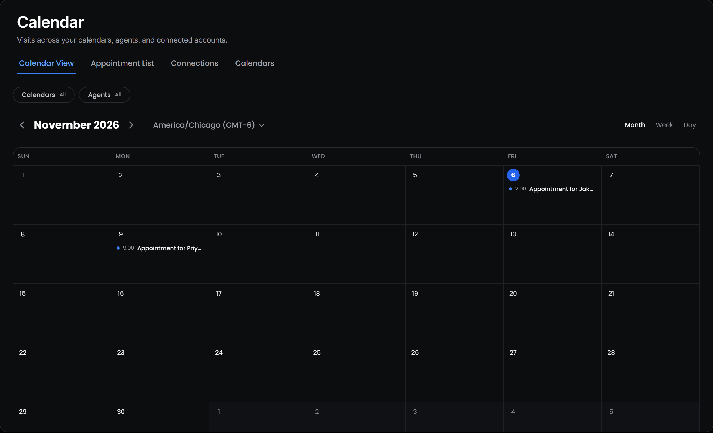
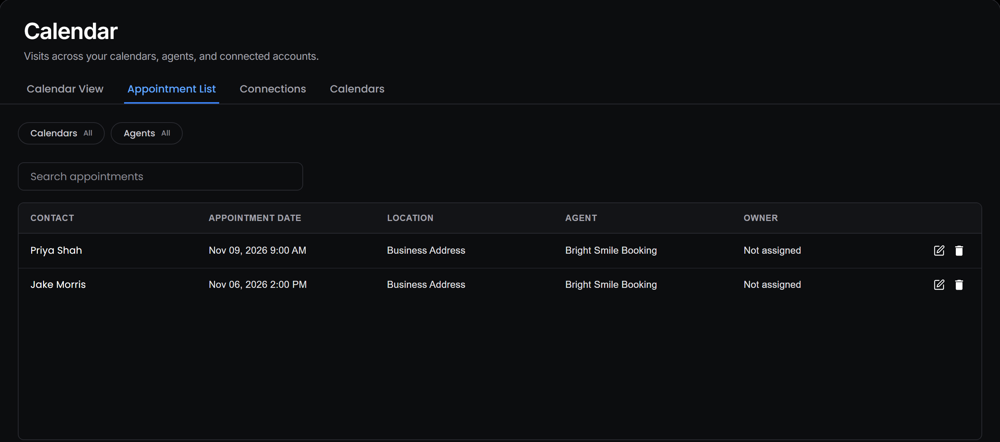
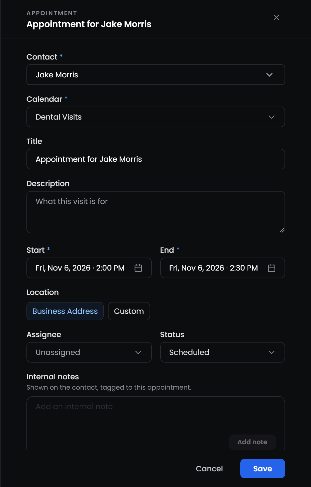
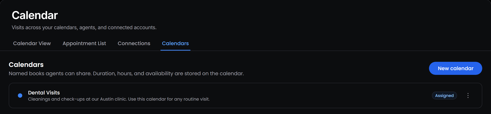
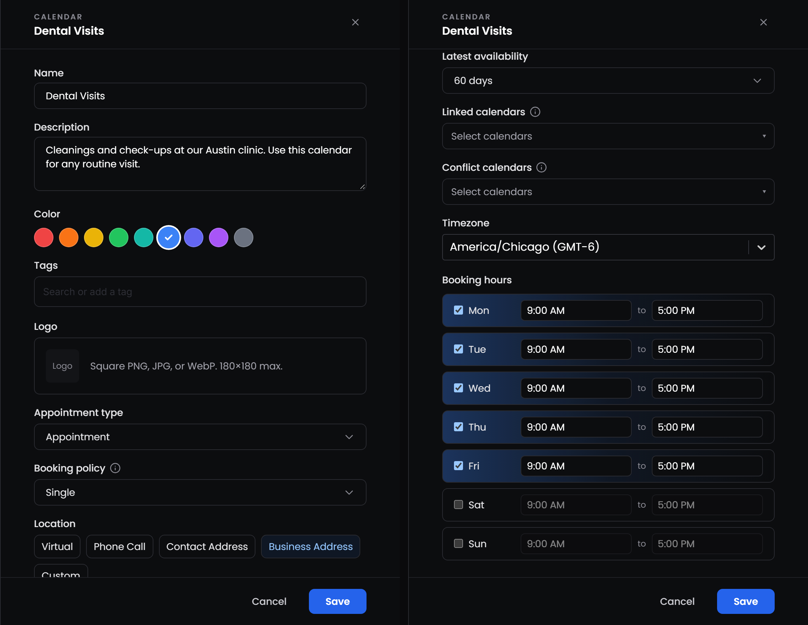
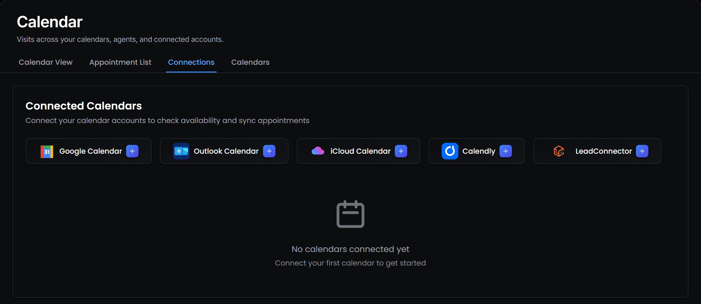

---
title: "Calendars"
---

<Badge>Every booking in one view</Badge> <Badge>Calendars agents share</Badge> <Badge>Synced with Google and HighLevel</Badge>

## **What is the Calendars page?**

The Calendars page holds every appointment in your workspace, whether an agent booked it or someone on your team added it. It's also where you create the calendars your agents book into and connect the calendar accounts you already use.

Select **Calendars** in the sidebar to open it. The page has four tabs:

<Columns cols={2}>
  <Column>
    <Card title="**Calendar View**" icon="calendar-days" href="#how-do-i-see-my-appointments">
      Your appointments by month, week or day.
    </Card>

    <Card title="**Appointment List**" icon="list" href="#how-do-i-see-my-appointments">
      The same appointments as a table you can search.
    </Card>
  </Column>
  <Column>
    <Card title="**Connections**" icon="link" href="#how-do-i-manage-connected-calendars">
      The Google Calendar and HighLevel accounts you've connected.
    </Card>

    <Card title="**Calendars**" icon="calendar" href="#how-do-i-manage-my-calendars">
      The Myna calendars your agents book into, with their hours and rules.
    </Card>
  </Column>
</Columns>

Creating your first calendar and linking it to Google Calendar or HighLevel is covered step by step in [Launch your first agent](/platform/getting-started/launch-your-first-agent#how-do-i-connect-my-real-calendar). This page covers everything else.

## **How do I see my appointments?**

**Calendar View** shows your appointments on a calendar. Use **Month**, **Week** or **Day** to change the view, and the arrows to move forward or back. Each appointment shows its time and title, in the colour of its calendar.

**Appointment List** shows the same appointments as a table, newest first, with the contact, date, location, agent and the teammate it's assigned to. Type in **Search appointments** to find one.

On both tabs, use the **Calendars** and **Agents** filters to show only some calendars or agents, and **Clear** to show everything again. Select an appointment to open its details.

<Note>
  The time zone menu next to the month changes the time zone for your **whole workspace**, not just your view. Check with your team before you change it.
</Note>

If you've connected HighLevel, appointments from your HighLevel calendars appear here too, in orange. You can open them, but you change them in HighLevel. Google Calendar events don't appear in Myna. They only block those times, so your agents never offer them.

## **How do I add an appointment myself?**

Select an empty day in **Calendar View** to open a new appointment for that day, or open an existing appointment to change it.

<table>
  <colgroup>
    <col width="160" />
    <col width="540" />
  </colgroup>
  <thead>
    <tr>
      <th>**Field**</th>
      <th>**What to enter**</th>
    </tr>
  </thead>
  <tbody>
    <tr>
      <td>**Contact**</td>
      <td>Who the appointment is with. Choose **None - Blocked off time** to block time without a contact, such as a lunch break or a day off</td>
    </tr>
    <tr>
      <td>**Calendar**</td>
      <td>The calendar the appointment belongs to</td>
    </tr>
    <tr>
      <td>**Title** and **Description**</td>
      <td>What the visit is called and what it's for</td>
    </tr>
    <tr>
      <td>**Start** and **End**</td>
      <td>When it happens. The end time fills in from the calendar's duration</td>
    </tr>
    <tr>
      <td>**Location**</td>
      <td>One of the locations the calendar allows, or **Custom**</td>
    </tr>
    <tr>
      <td>**Assignee**</td>
      <td>The teammate who will see the customer</td>
    </tr>
    <tr>
      <td>**Status**</td>
      <td>**Scheduled**, **Confirmed**, **Completed** or **Cancelled**</td>
    </tr>
    <tr>
      <td>**Internal notes**</td>
      <td>Notes for your team. They also appear on the contact's **Notes** tab, tagged to this appointment</td>
    </tr>
  </tbody>
</table>

Select **Schedule** to create the appointment, or **Save** to keep your changes.

<Warning>
  Myna doesn't check your booking hours or other appointments when you add one yourself, so you can book outside your hours or on top of another visit. Check the calendar first. Your agents always check availability before they book.
</Warning>

To cancel an appointment, set its **Status** to **Cancelled**, which frees the time for your agents. To remove it completely, select <Icon icon="trash" /> **Delete appointment** in the **Appointment List**. Deleting also cancels any copies in Google Calendar or HighLevel.

## **How do my agents use calendars?**

An agent books into the Myna calendars you choose in its **Scheduling** tool. Every booking rule comes from the calendar: its duration, booking hours, time zone, how soon and how far ahead customers can book, and its locations. Several agents can share one calendar.

When a customer wants an appointment, the agent:

1. **Picks the calendar.** With more than one calendar, the agent matches what the customer asked for against each calendar's name, description and tags. If it can't tell which one fits, it asks the customer a question first.
2. **Offers a time.** It suggests one open time within the calendar's rules, skipping anything already booked in Myna or busy in your conflict calendars.
3. **Books the time the customer picks.** It checks again that the time is still free, then books it. The agent only says an appointment is booked once it really is.
4. **Moves it if asked.** If **Modify Appointment** is on, the agent can move a booking to another open time later in the conversation.

Agent bookings appear in Calendar View straight away, with the status **Scheduled**, and are copied to any linked Google or HighLevel calendars. The contact's status changes to **Closed**.

<Note>
  The agent confirms the day and time in the conversation. Myna doesn't send separate reminder messages before the appointment.
</Note>

## **How do I manage my calendars?**

Open the **Calendars** tab to see every Myna calendar. Each one shows **Assigned** if at least one agent books into it, or **Unassigned** if none does. Hover over **Assigned** to see which agents use it.

Select **New calendar** to create one, or select <Icon icon="ellipsis-vertical" /> next to a calendar to **Edit**, **Duplicate** or **Delete** it.

- **Duplicate** creates a copy with **copy** added to its name, with all the same settings. It's a quick way to set up a second location or a different type of visit.
- **Delete** only works for calendars no agent uses and that have no appointments. Remove the calendar from your agents first.

### **Which settings can I change?**

The main settings, such as duration, booking hours and linked calendars, are explained in [Launch your first agent](/platform/getting-started/launch-your-first-agent#which-tools-does-the-agent-need). A calendar also has:

- **Color:** the colour of its appointments in Calendar View.
- **Tags:** words that describe the calendar. Like the description, they help an agent pick the right calendar when it has several.
- **Logo:** a square PNG, JPG or WebP image.
- **Appointment type:** **Appointment**, **Booking** or **Reservation**. This is the word your agent uses when it talks about the visit.
- **Location:** choose one or more of **Virtual**, **Phone Call**, **Contact Address**, **Business Address** and **Custom**. With **Custom**, write the place in your own words.
- **Soonest and latest availability:** besides the preset options, choose **Custom** to set a number of hours or days, or a fixed date, such as the day a new location opens.

<Tip>
  Agents offer times in 15-minute steps for 15-minute visits, and in 30-minute steps for every other duration.
</Tip>

## **How do I manage connected calendars?**

The **Connections** tab lists the calendar accounts you've connected and the calendars inside each one.

- **Google Calendar:** select **Google Calendar** to connect an account. Each account shows its calendars, marked **Primary** or **(Read-only)**. If Google access expires, the account shows **Reconnection required**. Select **Reconnect** to sign in again.
- **LeadConnector:** select **LeadConnector** to connect HighLevel in **Settings → Integrations**. Once connected, its calendars appear here, and **Manage** takes you back to the integration.

To disconnect a Google account, select <Icon icon="trash" /> next to it.

<Warning>
  Disconnecting a Google account removes its calendars from every agent and calendar that uses them. Agents then stop checking those calendars for busy times.
</Warning>
