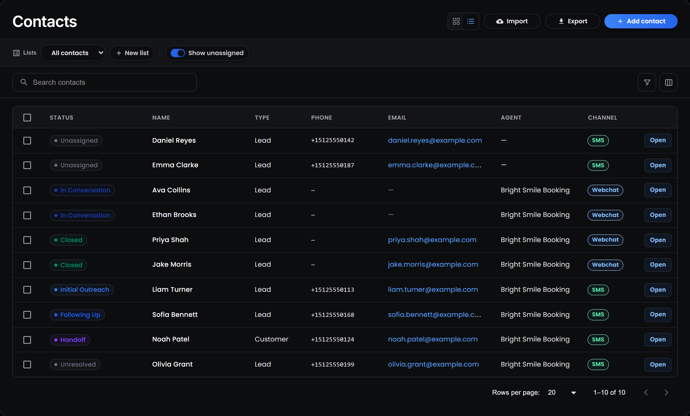
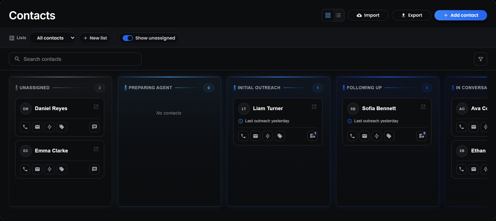
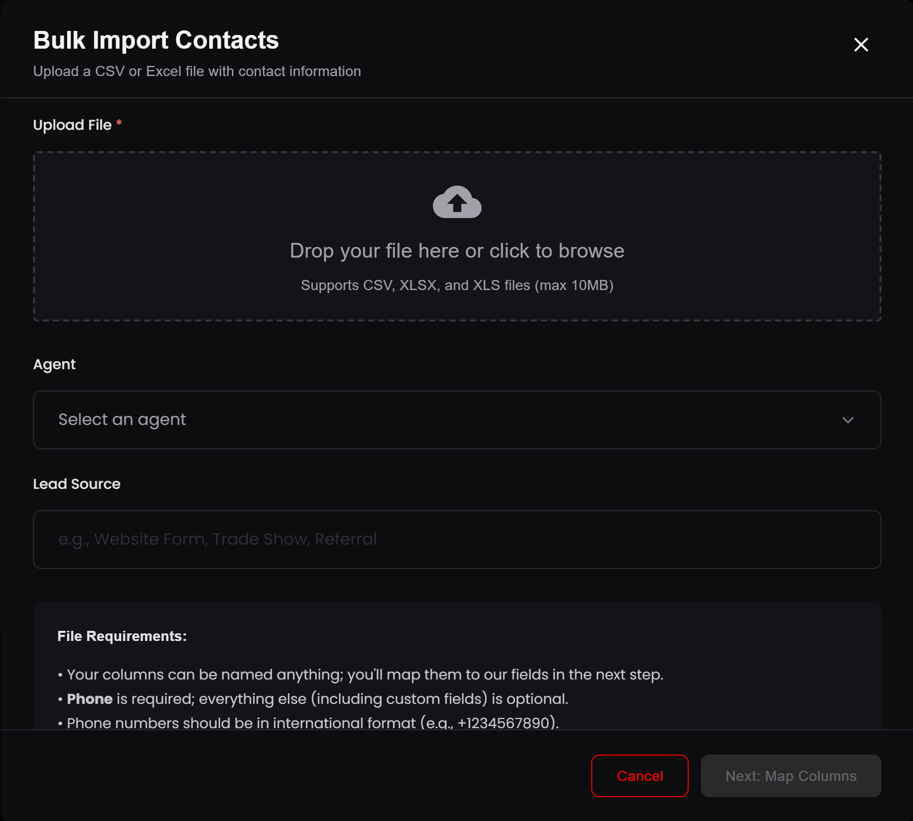
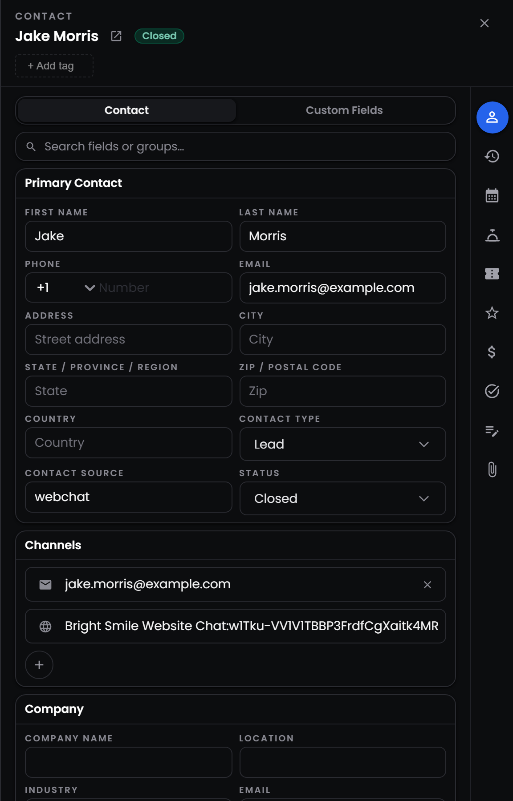
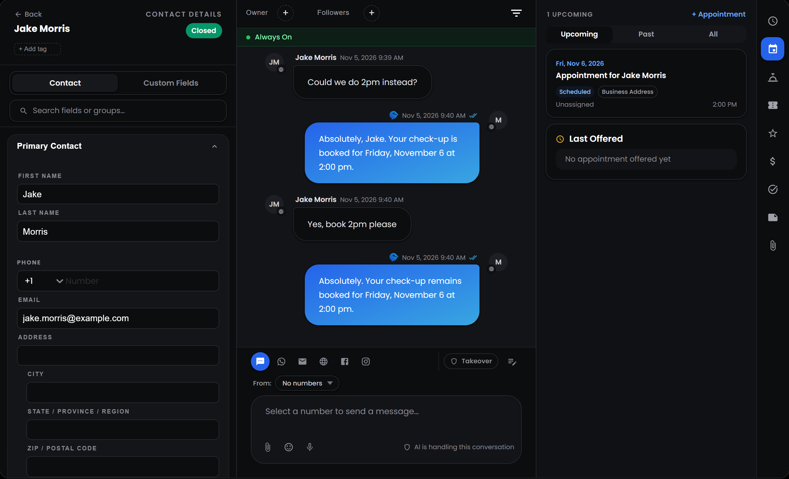

<Badge>Every customer in one place</Badge> <Badge>Import from a spreadsheet</Badge> <Badge>Hand contacts to an agent</Badge>

## **What is the Contacts page?**

Contacts are the people your agents talk to. Every customer who messages you, every lead you import and every prospect you add from Radar becomes a contact with its own record: their details, the agent working with them, where they are in the conversation, and everything that happened along the way.

The Contacts page is where you find, add, organise and hand those people to your agents. Select **Contacts** in the sidebar to open it.

## **How can I view my contacts?**

Use the two buttons next to **Import** to switch between views:

- **Board:** one column per status, from **Unassigned** to **Opt-Out**, with a card for each contact. Each card shows the contact's next step, such as an upcoming appointment, the last offered time or when the agent last reached out. Hover over the icons on a card to see the phone number, email, agent, tags and how many messages the agent has sent. Each column shows 10 cards at first, and **Load More** shows the rest.
- **List:** a table you can sort by any column. Select a column title once to sort A to Z, again for Z to A, and a third time to go back to the newest contacts first. Use **Rows per page** at the bottom to show 10, 20, 50 or 100 contacts at a time.

In list view, select <Icon icon="table-columns" /> **Customize columns** to choose which columns to show and drag them into the order you want. **Status**, **Name**, **Type**, **Phone**, **Email**, **Agent** and **Channel** show by default. You can also add **Messages**, **Source**, **Last Inbound**, **Last Outbound** and **Created**. Your layout is saved in your browser, so it stays the same next time you open the page.

Turn off **Show unassigned** to hide contacts that don't have an agent yet.

### **How do I find a contact?**

Type in **Search contacts** to search by name, email, phone number, status, agent, lead source, address or reference ID. If you type several words, Myna finds contacts that match all of them.

Select <Icon icon="filter" /> **Filter contacts** to narrow the list by:

- **Status:** any of the nine statuses.
- **Agent:** one agent, or **Unassigned**.
- **Type:** **Lead**, **Customer** or **Employee**.
- **Channel:** **SMS** or **Webchat**.

<Tip>
  Filters apply to every contact in list view. In board view they only filter the cards already loaded in each column, so switch to list view when you need an exact count.
</Tip>

## **What do the statuses mean?**

A contact's status shows where they are in their journey with your agent. The [Dashboard](/platform/explore/dashboard#what-does-the-live-funnel-show) explains each stage. Most status changes happen on their own:

<table>
  <colgroup>
    <col width="230" />
    <col width="470" />
  </colgroup>
  <thead>
    <tr>
      <th>**When this happens**</th>
      <th>**The status becomes**</th>
    </tr>
  </thead>
  <tbody>
    <tr>
      <td>You add a contact without an agent</td>
      <td>**Unassigned**</td>
    </tr>
    <tr>
      <td>You assign an agent</td>
      <td>**Preparing Agent**</td>
    </tr>
    <tr>
      <td>The agent sends its first message</td>
      <td>**Initial Outreach**</td>
    </tr>
    <tr>
      <td>The contact replies</td>
      <td>**In Conversation**</td>
    </tr>
    <tr>
      <td>The contact stops replying for a while</td>
      <td>**Following Up**</td>
    </tr>
    <tr>
      <td>The agent books an appointment</td>
      <td>**Closed**</td>
    </tr>
    <tr>
      <td>The agent hands the conversation to your team</td>
      <td>**Handoff**</td>
    </tr>
    <tr>
      <td>The agent reaches its message limit without an outcome</td>
      <td>**Handoff** if the contact showed interest, otherwise **Unresolved**</td>
    </tr>
    <tr>
      <td>The contact asks not to be messaged</td>
      <td>**Opt-Out**</td>
    </tr>
  </tbody>
</table>

**Closed**, **Handoff**, **Unresolved** and **Opt-Out** are final. Once a contact reaches one of them, Myna stops changing their status on its own, except when they opt out or book an appointment. You can always change a status yourself from the contact's record.

## **How do I add contacts?**

There are three ways to add contacts yourself. Contacts also arrive on their own when someone messages one of your channels, and from [Radar](/platform/explore/radar).

<Columns cols={3}>
  <Column>
    <Card title="**Add contact**" icon="user-plus" href="#adding-one-contact">
      Fill in one contact's details by hand.                  
    </Card>
  </Column>
  <Column>
    <Card title="**Import**" icon="file-arrow-up" href="#importing-a-spreadsheet">
      Upload a CSV or Excel file with up to 2,000 contacts.
    </Card>
  </Column>
  <Column>
    <Card title="**Radar**" icon="satellite-dish" href="/platform/explore/radar">
      Find new prospects and add them with their details filled in.
    </Card>
  </Column>
</Columns>

### **Adding one contact**

Select **Add contact**. A panel opens with the contact's fields, grouped into:

- **Primary Contact:** first and last name, phone, email, address, country, **Contact Type** (Lead, Customer or Employee) and **Contact Source**.
- **Channels:** the ways to reach the contact. Select <Icon icon="plus" /> to add an SMS number, email address, WhatsApp, Instagram or LinkedIn.
- **Agent:** the agent who will work with this contact.
- **Secondary Contact:** another person to reach, such as a partner or parent, with their phone number and relationship.
- **General Info:** notes about the contact, **Lead Cost**, **Deal Value** and **Myna Notes**, which are internal notes for your team.

The **Custom Fields** tab shows the fields you created in **Settings → Contact Fields**. No field is required, but your agent can only text a contact who has a phone number. Select **Create contact** to save.

<Note>
  Myna uses the phone number to spot duplicates. If a contact with the same number already exists, you'll see **Contact already exists**. Numbers without a country code are treated as US numbers.
</Note>

### **Importing a spreadsheet**

Select **Import** to add many contacts at once.

<Steps>
  <Step title="**Upload your file**">
    Drop a CSV, XLSX or XLS file into the window, up to 10 MB and 2,000 rows. Every row needs a phone number, ideally in international format, such as +15125550142. Rows without one are skipped.

    You can also choose an **Agent** for every contact in the file, and a **Lead Source**, such as Website Form or Referral. If you leave the lead source empty, it's set to Unknown.
  </Step>
  <Step title="**Map your columns**">
    Select **Next: Map Columns**. For each column in your file, choose the Myna field it fills, such as **First Name**, **Phone** or **City**. Myna matches common column names for you. Use **Full Name** if your file has one column for the whole name, and Myna splits it into first and last name.

    Any column Myna can't match becomes a **new custom field** by default. Choose **(Don't import)** for columns you don't need.
  </Step>
  <Step title="**Choose what happens to duplicates**">
    Contacts are matched by phone number. Duplicates are skipped by default. Turn on **Overwrite duplicates** to update existing contacts with the values in your file instead. Empty cells never erase existing details.
  </Step>
  <Step title="**Import**">
    Select **Import Contacts**. Myna tells you how many contacts were created, updated and skipped.
  </Step>
</Steps>

Every imported contact is saved as a **Lead**. If you chose an agent, the contacts start as **Preparing Agent** and the agent starts reaching out to them. Otherwise they start as **Unassigned**.

## **How do I hand a contact to an agent?**

Assigning a contact to an agent is how an agent starts working with someone. You can assign an agent:

- **To one contact:** open the contact, choose an **Active Agent** and select **Save**.
- **To many contacts:** in list view, select the contacts with the checkboxes, then select **Update agent**. Choose **None** to remove their agent instead.
- **While importing:** choose an **Agent** in the import window.

When you assign an agent, the contact's status changes to **Preparing Agent**. If the agent reaches out first, it then sends its intro message on its own, within its reply schedule and as long as you have credits. Agents that only answer incoming messages, and contacts who only reach you through web chat, wait for the customer to write first.

If you move a contact to a different agent, the new agent starts fresh: its message count and follow-ups start again from zero. The conversation history and everything the agent saved stay on the contact.

<Tip>
  Use **Select all** in the selection bar to assign every contact that matches your search and filters, not just the ones on the current page. Contacts without a phone number are left out.
</Tip>

## **What's on a contact's record?**

Select a contact to open their details in a panel on the side of the page. Select <Icon icon="arrow-up-right-from-square" /> **Open full contact page** to see everything on one screen.

The full contact page has three columns:

- **Contact details:** all the contact's fields, their status and tags. Select the status to change it. The **Agents** section shows the active agent, with **Replace Agent** and **Remove Agent**, and **Show details** reveals how many messages it has sent and its last follow-up step. The **Company** section links the contact to a company, which you can find or create as you type.
- **Conversation:** every message between the contact and your agents, on every channel. You can reply here too, the same way as in [Conversations](/platform/explore/conversations).
- **Activity and records:** tabs for the contact's **Activity** (every change to their record, with the date), **Appointments**, **Tickets**, **Tasks**, **Notes** and **Attachments**. Notes added to a ticket or appointment also appear under **Notes**, tagged with where they came from.

Changes to fields aren't saved until you select **Save**.

## **What are tags?**

Tags are labels you add to contacts, such as VIP or Spring promo. Select **+ Add tag** at the top of any contact's record, then pick a tag or type a new one and select **Create**. Tags save as soon as you add or remove them. You can manage your tags in **Settings → Custom Tags**.

## **How do opt-outs work?**

When a contact texts one of these words on its own, Myna marks them as **Opt-Out** and your agents stop messaging them:

**STOP**, **STOP ALL**, **UNSUBSCRIBE**, **CANCEL**, **END**, **QUIT**, **REVOKE** or **OPT OUT**

Myna also catches phrases such as "stop texting me", "remove me from your list" and "opt me out" anywhere in a message. If the contact later texts **START**, **RESUME** or **OPT-IN**, they're moved back to **In Conversation** and your agents can reply again.

<Note>
  Opt-out words apply to text messages. Web chat visitors start every conversation themselves, so they're never messaged without asking.
</Note>

## **How do I export or delete contacts?**

- **Export:** select **Export** to download every contact in your workspace as a CSV file, whatever search or filters you have on. The file includes contact details, status, agent, message counts and dates. Tags and custom fields aren't included.
- **Delete one contact:** select the <Icon icon="trash" /> icon on their row, or **Delete contact** at the bottom of their full page.
- **Delete several:** select them in list view, then select **Delete**.

<Warning>
  Deleting a contact can't be undone. It also deletes their messages, notes, tickets, appointments and everything your agents remembered about them. Appointments that were copied to Google Calendar or HighLevel are cancelled there too.
</Warning>
