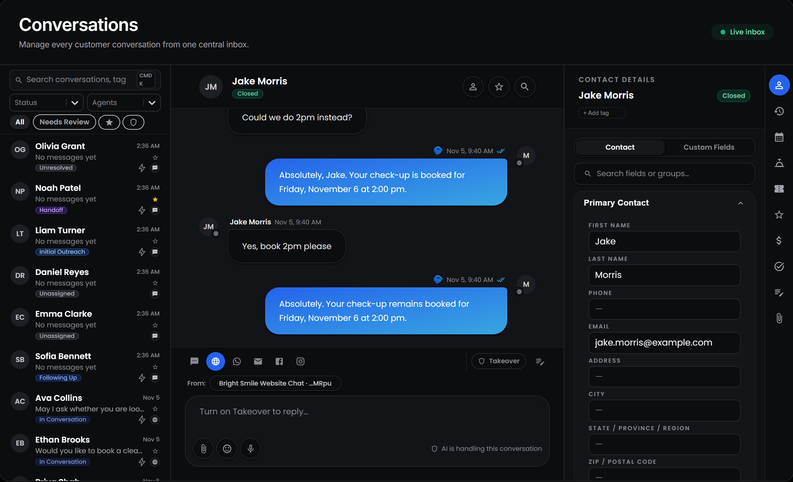
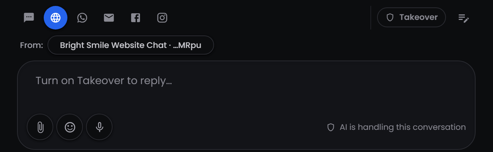

---
title: "Conversations"
---

<Badge>One inbox for every channel</Badge> <Badge>Step in when it matters</Badge> <Badge>Notes only your team sees</Badge>

## **What is the Conversations page?**

Conversations is your team's inbox. Every message between your agents and your customers lands here, whatever the channel: SMS, web chat, and the channels you connect through HighLevel. You can read along while your agents work, step in when a customer needs a person, and leave notes for your team.

Select **Conversations** in the sidebar to open it.

The page has three columns:

- **Inbox:** every contact, with the latest conversation at the top.
- **Thread:** the full conversation with the contact you selected.
- **Contact details:** the contact's record, with tabs for their activity, appointments, tickets, tasks, notes and files.

The inbox refreshes on its own every 30 seconds, and an open conversation every 15 seconds, so new messages appear without reloading the page.

<Note>
  The thread and contact panel need a tablet or computer screen. On a phone, the page only shows the inbox.
</Note>

## **How do I find a conversation?**

Each row in the inbox shows the contact's name, a preview of the last message, when it was sent, the contact's status and the channel. Select a row to open the conversation.

To narrow the inbox:

- **Search:** type a name, email, phone number, status or agent.
- **Status** and **Agents:** pick one or more statuses or agents.
- **Quick filters:** **All**, **Needs Review**, <Icon icon="star" /> **Starred** or <Icon icon="shield" /> **Takeover**.

Star a conversation with the <Icon icon="star" /> next to it, or at the top of the thread, to find it again later.

### **What does Needs Review mean?**

A conversation needs review when a message came in through HighLevel for a contact that has no agent. Myna holds the reply instead of guessing which agent should answer, and shows a banner at the top of the thread. Select **Assign an agent** in the banner to choose one, and the agent starts replying again.

## **What's in a conversation?**

Messages from the customer appear on the left with their name. Messages your side sends appear on the right in blue. Each message shows when it was sent and the channel it came through, and messages that came from HighLevel are marked **via LeadConnector**. Photos, videos and files that web chat visitors send open right in the thread.

At the top of the thread:

- <Icon icon="user" /> **Contact details** opens the contact panel.
- <Icon icon="star" /> **Star conversation** adds the conversation to **Starred**.
- <Icon icon="magnifying-glass" /> **Search messages** finds words in this conversation and highlights every match.

Scroll up to load older messages.

## **How do I step in and reply myself?**

Your agent handles every conversation until someone on your team takes over. Select <Icon icon="shield" /> **Takeover** above the message box.

While takeover is on:

- The agent stops replying to this contact, and doesn't send any follow-ups or outreach.
- The customer's messages still arrive in the thread, so your team can answer them.
- The conversation shows a **Takeover** badge in the inbox, and the <Icon icon="shield" /> filter lists every conversation your team has taken over.

Write your reply in the message box and press **Enter** to send it. Press **Shift + Enter** to start a new line. Web chat replies appear in the visitor's chat window straight away. Text messages go out from the number selected in **From**, which is the agent's number by default.

Select **Takeover** again when you're done, and the agent can reply to the contact's next messages.

<Warning>
  The agent doesn't go back and answer messages that arrived while takeover was on. Reply to them yourself before you hand the conversation back.
</Warning>

<Info>
  Takeover also turns on by itself when an agent hands a conversation to your team with **Hand Off to Human**. The contact's status changes to **Handoff**, so you can find these conversations with the **Status** filter.
</Info>

## **How do I leave a note for my team?**

Select <Icon icon="pen-to-square" /> **Internal Comment** next to **Takeover**, write your note and select **Save note**. Internal comments appear in the thread in amber, between the messages, and are never sent to the customer. Use them to explain why you took over, or to pass the conversation to a teammate with some context.

For notes that should stay with the contact rather than the conversation, use the **Notes** tab in the contact panel.

## **What's in the contact panel?**

The panel on the right shows the contact you're talking to, so you rarely need to leave the inbox. You can:

- Edit their details and custom fields, then select **Save**.
- Add or remove tags with **+ Add tag**.
- Change the **Active Agent** working with them.
- Use the icons on the right edge to see their **Activity**, **Appointments**, **Tickets**, **Tasks**, **Notes** and **Attachments**.

To see everything about the contact on one screen, open their full page from [Contacts](/platform/explore/contacts#whats-on-a-contacts-record).
