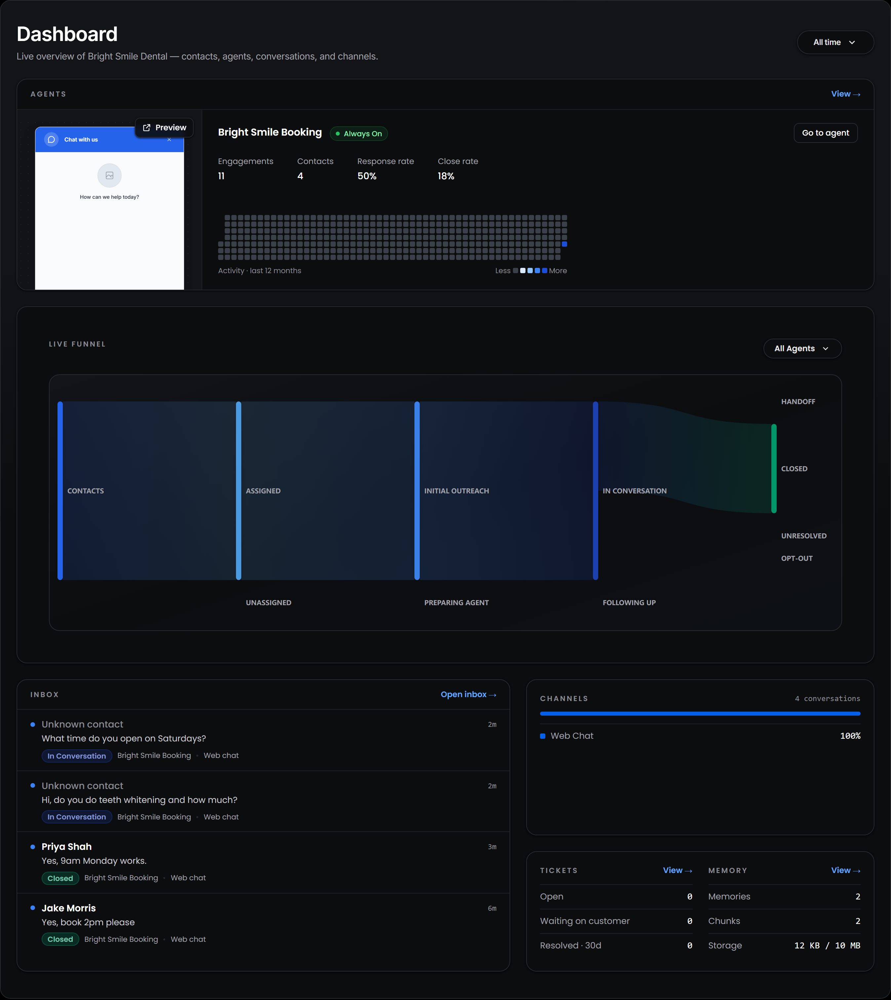
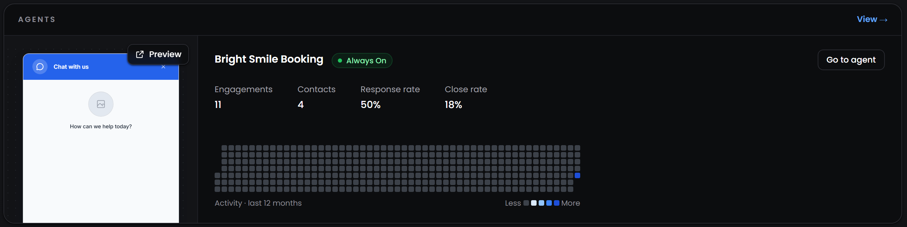
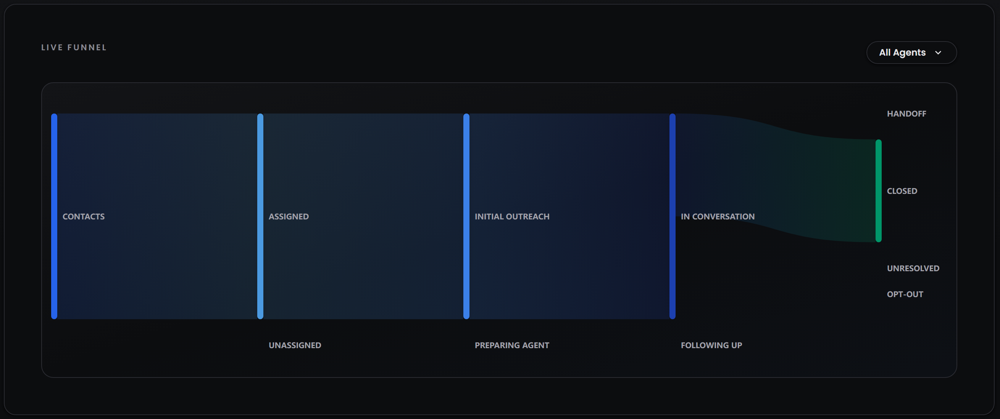
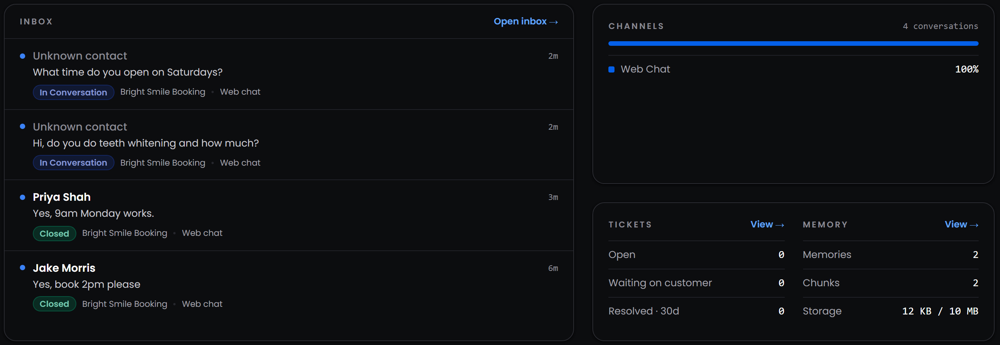

---
title: "Dashboard"
---

<Badge>Your workspace at a glance</Badge> <Badge>Every agent side by side</Badge> <Badge>Updated from real activity</Badge>

## **What is the Dashboard?**

The Dashboard is the first page you see when you sign in. It brings together what your agents are doing across your whole workspace: how busy each agent is, where your contacts are in their journey, the latest messages from customers, and a quick look at your channels, tickets and knowledge.

Everything on it comes from real activity. Playground tests use a demo contact, so they don't count towards your numbers.

The page is built from five cards, each with a link to the page where you can act on what you see:

<Columns cols={2}>
  <Column>
    <Card title="**Agents**" icon="robot">
      One page per agent, with its key numbers and a year of daily activity.
    </Card>

    <Card title="**Live Funnel**" icon="filter">
      Where your contacts are, from first message to the outcome of the conversation.
    </Card>
  </Column>
  <Column>
    <Card title="**Channels**" icon="tower-broadcast">
      How your conversations are split across SMS, Web Chat, email and your other channels.
    </Card>

    <Card title="**Tickets and Memory**" icon="ticket">
      Open support tickets, and how much knowledge your agents have to work with.
    </Card>
  </Column>
</Columns>

<Card title="**Inbox**" icon="inbox">
  The latest messages customers sent, with the agent and channel that handled each one.
</Card>

<Tip>
  New workspaces also see the **Onboarding Checklist** at the top of the Dashboard. It's covered in [Set up your workspace](/platform/getting-started/set-up-your-workspace#what-should-i-set-up-before-deploying-my-first-agent). Select **Hide** once you've finished with it.
</Tip>

## **How do I change the time period?**

Use the menu in the top right corner of the page to choose **All time**, **Last 7 days**, **Last 30 days** or a custom range with a start and end date. The agent numbers and the Live Funnel update to match.

## **How do I read the Agents card?**

The Agents card gives each agent its own page. The busiest agent, the one with the most contacts, opens first. The others fold into narrow tabs on the side that show the agent's name and how many contacts it has. Select a tab to open that agent's page. The card shows up to eight agents, and **View** takes you to the full list on the [Agents](/platform/explore/agents) page.

Each page shows:

- **Availability:** whether the agent is replying right now, based on its reply schedule. The [Agents](/platform/explore/agents#what-does-the-availability-badge-mean) page explains each state.
- **Web chat preview:** if the agent answers on a Web Chat widget, a preview of the widget appears on the left. Select **Preview** to open the live widget in a new tab and chat with it as a customer would.
- **Go to agent:** opens the agent's own page with its full analytics.
- **Numbers for the time period you chose:**

<table>
  <colgroup>
    <col width="160" />
    <col width="540" />
  </colgroup>
  <thead>
    <tr>
      <th>**Number**</th>
      <th>**What it counts**</th>
    </tr>
  </thead>
  <tbody>
    <tr>
      <td>**Engagements**</td>
      <td>Messages customers sent to the agent</td>
    </tr>
    <tr>
      <td>**Contacts**</td>
      <td>Contacts assigned to the agent</td>
    </tr>
    <tr>
      <td>**Response rate**</td>
      <td>Out of the contacts the agent messaged, the share who replied</td>
    </tr>
    <tr>
      <td>**Close rate**</td>
      <td>Appointments the agent booked compared with its engagements</td>
    </tr>
  </tbody>
</table>

Below the numbers, the activity grid shows one square per day for the last 12 months. The darker the square, the more happened that day: messages received and sent, appointments booked and errors. Hover over a square to see the exact count and date.

<Note>
  Daily activity is visible to workspace Owners and Admins. Other roles see the agent's numbers without the grid.
</Note>

## **What does the Live Funnel show?**

The Live Funnel follows your contacts from the moment they're added to the outcome of their conversation. Each column is a stage, and the width of each band shows how many contacts moved from one stage to the next. Use the menu in the top right corner of the card to see **All Agents** or one agent at a time.

<table>
  <colgroup>
    <col width="160" />
    <col width="540" />
  </colgroup>
  <thead>
    <tr>
      <th>**Stage**</th>
      <th>**What it means**</th>
    </tr>
  </thead>
  <tbody>
    <tr>
      <td>**Contacts**</td>
      <td>Every contact in your workspace</td>
    </tr>
    <tr>
      <td>**Assigned / Unassigned**</td>
      <td>Whether the contact has an agent working with them</td>
    </tr>
    <tr>
      <td>**Preparing Agent / Initial Outreach**</td>
      <td>The agent is getting ready to message the contact, or has sent its first message</td>
    </tr>
    <tr>
      <td>**In Conversation / Following Up**</td>
      <td>The contact is talking with the agent, or stopped replying and the agent is following up</td>
    </tr>
    <tr>
      <td>**Outcome**</td>
      <td>How the conversation ended: **Closed** (the job is done, such as a booking), **Handoff** (passed to your team), **Unresolved** (ended without an outcome) or **Opt-Out** (the contact asked not to be messaged)</td>
    </tr>
  </tbody>
</table>

The time period applies to when contacts were added, so **Last 7 days** shows the journey of the contacts you got this week.

<Info>
  A new workspace sees the full shape of the funnel with every stage at zero, so you can see the path contacts will take before your first conversation.
</Info>

## **What else is on the Dashboard?**

The bottom of the page gives you a quick check on the rest of your workspace.

- **Inbox:** the six most recent messages from customers. Each one shows the contact's name, what they wrote, how long ago, their current stage, and the agent and channel that handled it. **Unknown contact** means the agent hasn't saved the person's name yet. Select a message or **Open inbox** to go to [Conversations](/platform/explore/conversations).
- **Channels:** the total number of conversations and the share that came through each channel, such as SMS, Web Chat, email or a HighLevel channel.
- **Tickets:** how many tickets are **Open**, **Waiting on customer**, and **Resolved** in the last 30 days. **View** opens [Tickets](/platform/explore/tickets).
- **Memory:** how many memories your agents can search, how many **chunks** they're split into, and how much of your storage they use. **View** opens [Memory Hub](/platform/explore/memory-hub).

<Tip>
  A memory is something you added, such as a file, a web page or an FAQ. Myna splits each one into smaller passages, called chunks, so your agent can find the exact part that answers a question.
</Tip>
