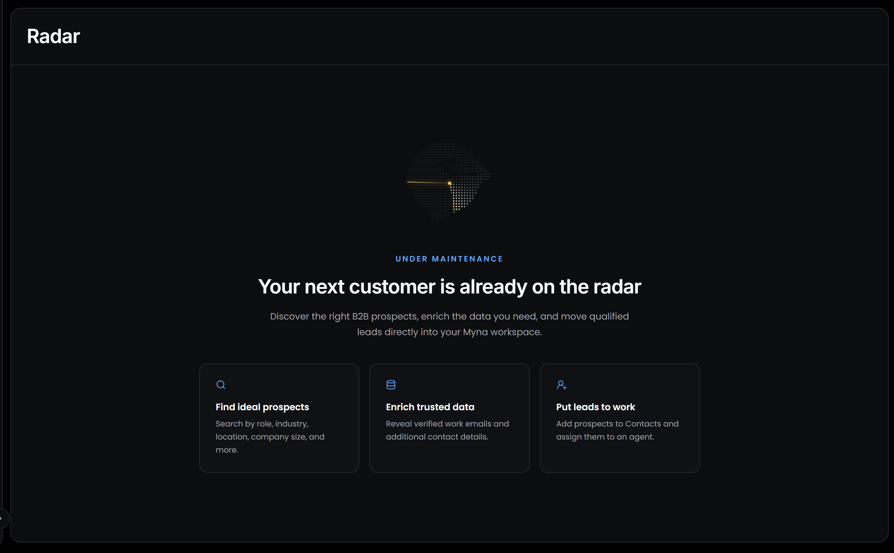
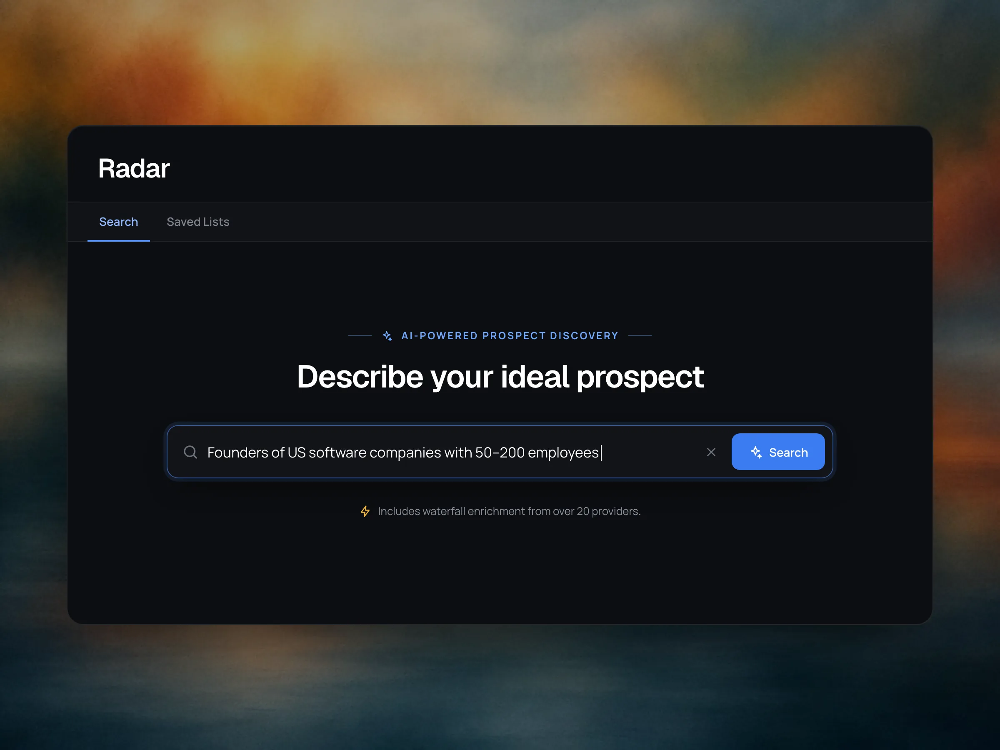
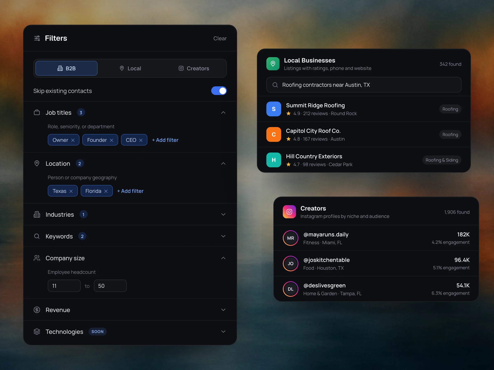
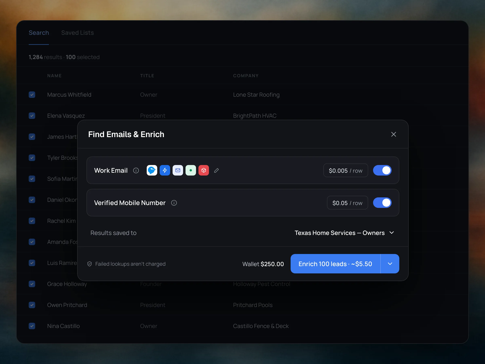

---
title: "Radar"
---

<Badge>Find your next customers</Badge> <Badge>Enrich their contact details</Badge> <Badge>Hand them straight to an agent</Badge>

## **Does Myna only build agents?**

Agents are at the heart of Myna, but the platform also includes optional tools that work alongside them. You don't need any of them to build and run an agent. Each one covers a job that usually needs a separate app, and because they live in the same workspace, your agents can work with what they produce.

<Columns cols={2}>
  <Column>
    <Card title="**Radar**" icon="satellite-dish" href="#what-is-radar">
      Find businesses and people to reach out to, then give them to an agent. Covered on this page.
    </Card>

    <Card title="**Calendars**" icon="calendar" href="/platform/explore/calendars">
      Calendars your agents book into, with their own availability, linked to Google Calendar or HighLevel.
    </Card>
  </Column>
  <Column>
    <Card title="**Reputation**" icon="star" href="/platform/explore/reputation">
      Track your ratings, reply to reviews and ask happy customers to leave one. Coming soon.
    </Card>

    <Card title="**Tickets**" icon="ticket" href="/platform/explore/tickets">
      Support requests your agents open and update, for your team to follow.
    </Card>
  </Column>
</Columns>

Radar is the one that brings new people into your workspace. Your other tools help you look after the customers who already reach you.

## **What is Radar?**

Radar is Myna's built-in prospecting tool. You describe the customers you're looking for, Radar finds the businesses and people that match, fills in their contact details, and adds them to your workspace with an agent ready to reach out.

Without it, this usually takes a lead database, an enrichment tool and a separate outreach tool. With Radar, the leads you find become [Contacts](/platform/explore/contacts) your agents can talk to straight away.

<Warning>
  Radar is **under maintenance** while we upgrade it. Select **Radar** in the sidebar to see its status. The sections below describe how Radar works, so you're ready to use it as soon as it's back.
</Warning>

## **How does Radar work?**

<Steps>
  <Step title="**Describe your ideal prospect**">
    Write who you're looking for in plain words, the way you'd brief a salesperson, such as "Owners of home service companies in Texas with 10 to 50 employees". Radar turns your description into search filters for you.

    
  </Step>
  <Step title="**Refine the results**">
    Adjust the filters to narrow the list, then preview the people and companies that match. Previewing is free.
  </Step>
  <Step title="**Enrich the leads you want**">
    Select the prospects you want to contact and choose the details to find for them, such as a verified work email or mobile number.
  </Step>
  <Step title="**Put the leads to work**">
    Add the prospects to your Contacts and assign them to an agent, which starts the conversation for you.
  </Step>
</Steps>

## **What can I search for?**

Radar searches three kinds of sources. Choose one at the top of the **Filters** panel.

<table>
  <colgroup>
    <col width="130" />
    <col width="570" />
  </colgroup>
  <thead>
    <tr>
      <th>**Source**</th>
      <th>**What you find**</th>
    </tr>
  </thead>
  <tbody>
    <tr>
      <td>**B2B**</td>
      <td>Decision makers at companies, such as owners, founders and managers</td>
    </tr>
    <tr>
      <td>**Local**</td>
      <td>Local businesses by category and area, with their rating, number of reviews, phone number and website</td>
    </tr>
    <tr>
      <td>**Creators**</td>
      <td>Instagram profiles by niche, location and audience, with their number of followers and engagement</td>
    </tr>
  </tbody>
</table>

For B2B searches, you can filter by:

- **Job titles:** role, seniority or department, such as Owner, Founder or CEO.
- **Location:** where the person or the company is based.
- **Industries:** the sector the company works in.
- **Keywords:** words that describe the company or what it does.
- **Company size:** a range of employees, such as 11 to 50.
- **Revenue:** the company's yearly revenue.

Turn on **Skip existing contacts** to leave out anyone who's already in your workspace, so you never pay to enrich someone twice or message an existing customer as a stranger.

## **How does enrichment work?**

A search gives you names and companies. **Enrichment** finds the details you need to actually reach them: a verified work email, a mobile number, or both.

Radar uses **waterfall enrichment**. Instead of asking one data provider, it checks more than 20 providers one after the other until it finds a verified match. This finds details for more of your prospects than any single provider could.

- **You choose what to pay for:** enrichment is charged per prospect, only for the details you select.
- **You see the cost first:** the total is shown before you confirm.
- **Failed lookups are free:** if no provider finds a detail, you aren't charged for it.

Enrichment is paid from your workspace balance in **Settings → Billing**.

## **How do leads reach my agents?**

When you add prospects from Radar, they're saved as contacts, with everything Radar found stored on their contact record. Assign them to an agent, and the agent starts the conversation using its intro message, asks your qualifying questions and books meetings, just as it does with any other contact.

You can follow every lead's progress in the [Live Funnel](/platform/explore/dashboard#what-does-the-live-funnel-show) on the Dashboard, from **Initial Outreach** to the outcome.

<Info>
  Radar can also run as the first step of a workflow in Workflow Studio, so prospecting, outreach, qualification and booking happen as one automated process. We cover workflows in the [Workflow Studio documentation](/workflow-studio).
</Info>

<Warning>
  Reaching out to people who haven't contacted you first comes with rules, and they differ by channel and country. Text messages in particular usually need the person's consent. Check that your outreach follows the rules that apply to you before you assign leads to an agent.
</Warning>
