<Badge>Built in Workflow Studio</Badge> <Badge>A real booking example</Badge> <Badge>From draft to live</Badge>

## **What are we building?**

The easiest way to learn how a Myna agent works is to build one. In this guide, we build a booking assistant for **Bright Smile Dental**, a fictional dental clinic in Austin, from a blank agent to a live one. By the end, the agent will:

<Columns cols={3}>
  <Column>
    <Card title="**Answer questions**" icon="comments">
      Tells patients about services, prices and policies, using what the clinic added to Memory Hub.
    </Card>
  </Column>
  <Column>
    <Card title="**Collect details**" icon="list-check">
      Asks for the type of visit and the patient's email, and saves them to the contact record.                   
    </Card>
  </Column>
  <Column>
    <Card title="**Book appointments**" icon="calendar-check">
      Offers open times from the clinic's calendar and books the one the patient picks.                                  
    </Card>
  </Column>
</Columns>

We start from scratch so you can see what each part of an agent does. Myna also has ready-made templates that set much of this up for you, which we cover at the end.

<Note>
  Your agent works best when your workspace is ready first. For this example, the clinic's [business profile](/platform/getting-started/set-up-your-workspace#why-does-my-agent-need-a-business-profile) is filled in, and General Memory holds its services, prices and cancellation policy.
</Note>

## **How do I create an agent?**

Go to **Agents** and select **Create Agent**. Myna creates a draft called **Untitled Agent** and opens it in Workflow Studio.

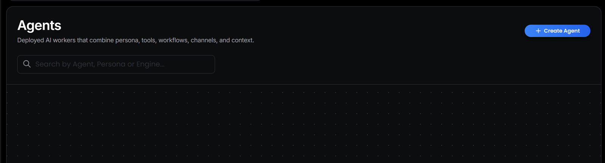

The canvas shows two blocks connected by a line:

- **Start:** where every conversation begins.
- **Agent Node:** the agent itself. It holds the instructions and tools the agent uses to handle the conversation.

The panel on the right has two tabs. **Global Settings** apply to the whole agent, and **Node Settings** apply to the Agent Node you select on the canvas.

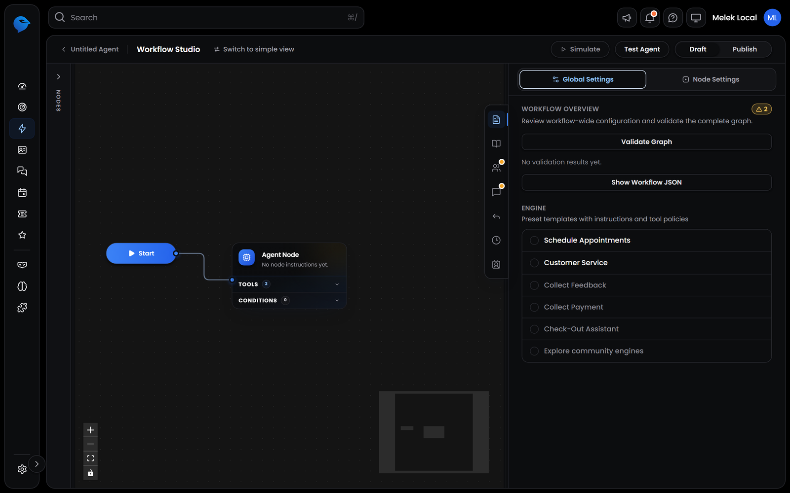

### **Workflow Studio or simple view?**

There are two ways to build your agent. Both edit the same agent, so you can switch between them at any time without losing anything.

<Columns cols={2}>
  <Column>
    <Card title="**Workflow Studio**" icon="diagram-project">
      The canvas you see when you create an agent. This is where you design workflows, where an agent moves through several steps to handle more complex jobs.
    </Card>
  </Column>
  <Column>
    <Card title="**Simple view**" icon="list">
      All of your agent's settings in one list, without the canvas. The straightforward way to build an agent that does one job well, like the booking agent in this guide.                                                                            
    </Card>
  </Column>
</Columns>

<Info>
  We cover workflows in the [Workflow Studio documentation](/workflow-studio).
</Info>

To change views, select **Switch to simple view** at the top of Workflow Studio, or **Switch to Workflow Studio** to go back. In this guide, we use the simple view.

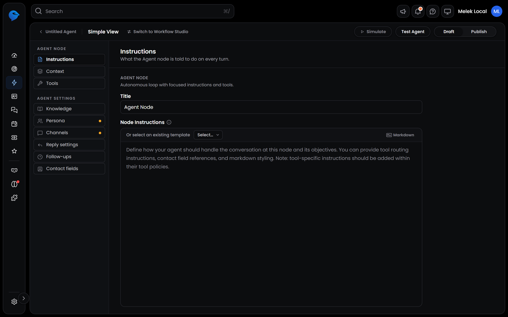

Before going further, give your agent a name. Open the agent's page by selecting its name at the top left, then select the name again to edit it. We named ours **Bright Smile Booking**. A new name applies straight away.

Everything you change is saved automatically to a **draft**. Customers only talk to your agent once you publish it, so you can take your time.

## **What makes up an agent?**

Every time a customer sends a message, the Agent Node reads its instructions and what it knows about the conversation, decides which tools to use, and then writes a reply in the agent's voice.

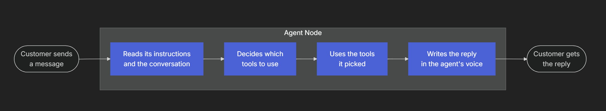

In the simple view, the settings are split into two groups:

<table>
  <colgroup>
    <col width="131" />
    <col width="268" />
    <col width="318" />
  </colgroup>
  <thead>
    <tr>
      <th>**Section**</th>
      <th>**What it controls**</th>
      <th>**In our example**</th>
    </tr>
  </thead>
  <tbody>
    <tr>
      <td>**Instructions**</td>
      <td>What the agent is told to do on every turn</td>
      <td>Book cleanings and check-ups, and answer questions</td>
    </tr>
    <tr>
      <td>**Context**</td>
      <td>What the agent can see about the business, contact and conversation</td>
      <td>Filled in from the business profile</td>
    </tr>
    <tr>
      <td>**Tools**</td>
      <td>The actions the agent can take</td>
      <td>Ask questions, save details and book appointments</td>
    </tr>
    <tr>
      <td>**Knowledge**</td>
      <td>The information the agent can search</td>
      <td>The clinic's services, prices and policies</td>
    </tr>
    <tr>
      <td>**Persona**</td>
      <td>The name and personality the agent speaks with</td>
      <td>Sophie, the front desk assistant</td>
    </tr>
    <tr>
      <td>**Channels**</td>
      <td>Where the agent talks to customers</td>
      <td>Web chat on the clinic's website</td>
    </tr>
    <tr>
      <td>**Reply settings**</td>
      <td>How and when the agent replies</td>
      <td>Default settings</td>
    </tr>
    <tr>
      <td>**Follow-ups**</td>
      <td>Messages sent when a customer stops replying</td>
      <td>None for now</td>
    </tr>
    <tr>
      <td>**Contact fields**</td>
      <td>Which customer details the agent can see and save</td>
      <td>Default settings</td>
    </tr>
  </tbody>
</table>

The first three belong to the **Agent Node**. The rest are **agent settings** and apply to the whole agent.

## **Which tools does the agent need?**

Tools are the actions your agent can take. The agent decides when to use each one, based on your instructions and the conversation.

Open **Tools**. Every agent starts with three:

- **Compose Reply:** writes the reply the customer receives. Always on.
- **Search Memory:** looks up information in your Memory Hub. Always on.
- **Update Contact:** saves details to the customer's record.

Select **Add tool** to add more:

<table>
  <colgroup>
    <col width="168" />
    <col width="511" />
  </colgroup>
  <thead>
    <tr>
      <th>**Tool**</th>
      <th>**What it lets the agent do**</th>
    </tr>
  </thead>
  <tbody>
    <tr>
      <td>**Ask Qualification**</td>
      <td>Ask the questions you set up, one at a time, and save the answers</td>
    </tr>
    <tr>
      <td>**Scheduling**</td>
      <td>Offer open times, book appointments and move them</td>
    </tr>
    <tr>
      <td>**Manage Tickets**</td>
      <td>Open and update support tickets for your team</td>
    </tr>
    <tr>
      <td>**Hand Off to Human**</td>
      <td>Pass the conversation to a teammate and stop replying</td>
    </tr>
    <tr>
      <td>**Send Call to Action**</td>
      <td>Send a link, phone number or email address you set up</td>
    </tr>
    <tr>
      <td>**Send GIF**</td>
      <td>Send a GIF after a reply when your instructions say to</td>
    </tr>
  </tbody>
</table>

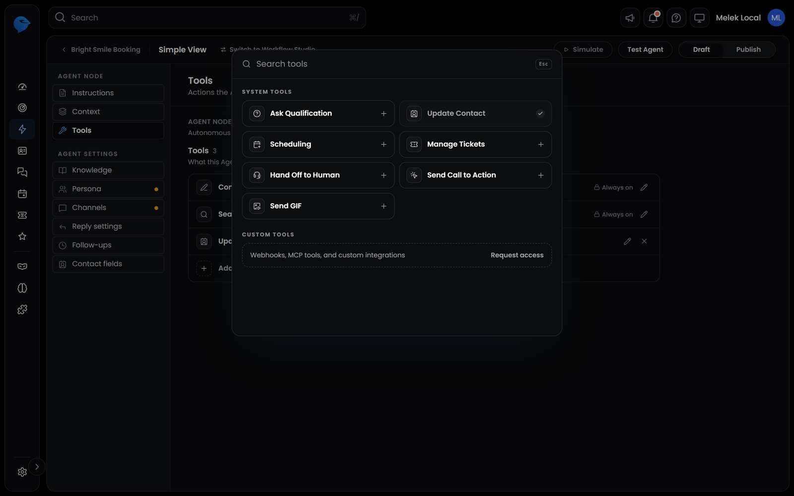

A booking agent needs two of these: **Ask Qualification**, to collect the details the clinic needs, and **Scheduling**, to book the visit. We add both.

<Info>
  Custom tools, such as webhooks and MCP tools, are available on request. Select **Request access** in the tool list.
</Info>

### **How do I set up Scheduling?**

Select the pencil next to **Scheduling** to open its settings.

Under **Capabilities**, choose what the agent is allowed to do:

<table>
  <colgroup>
    <col width="214" />
    <col width="501" />
  </colgroup>
  <thead>
    <tr>
      <th>**Capability**</th>
      <th>**What it does**</th>
    </tr>
  </thead>
  <tbody>
    <tr>
      <td>**Schedule Appointment**</td>
      <td>Books a specific date and time</td>
    </tr>
    <tr>
      <td>**Offer Appointment**</td>
      <td>Suggests open times when the customer hasn't picked one</td>
    </tr>
    <tr>
      <td>**Modify Appointment**</td>
      <td>Moves an appointment the customer already booked</td>
    </tr>
    <tr>
      <td>**Keep AI On After Booking**</td>
      <td>Keeps replying after a booking, for questions and changes. When it's off, the agent goes quiet and new messages wait for your team</td>
    </tr>
  </tbody>
</table>

Under **Calendars**, choose the calendar the agent books into. If you don't have one yet, select **Create New**.

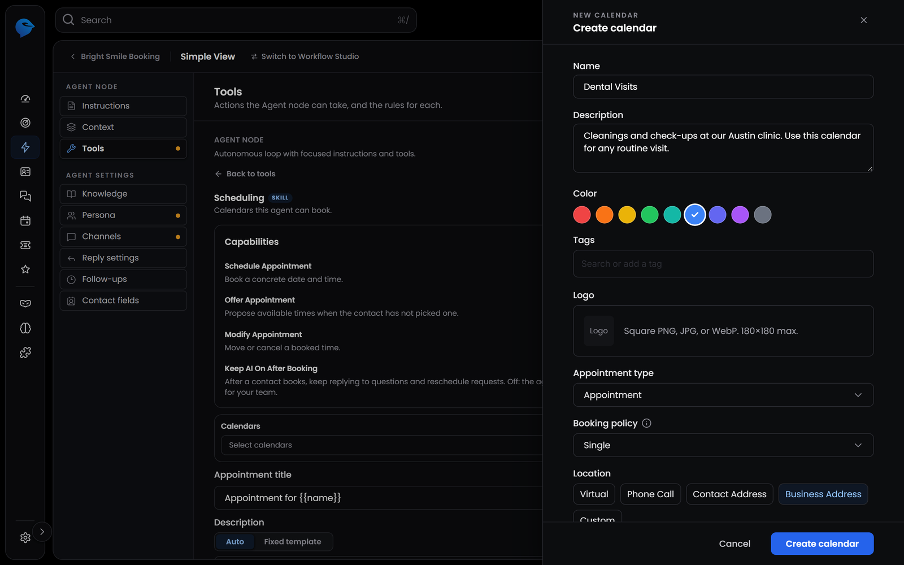

We created a calendar called **Dental Visits**. The main settings are:

<table>
  <colgroup>
    <col width="247" />
    <col width="460" />
  </colgroup>
  <thead>
    <tr>
      <th>**Setting**</th>
      <th>**What it means**</th>
    </tr>
  </thead>
  <tbody>
    <tr>
      <td>**Name and description**</td>
      <td>The description tells the agent what the calendar is for. If you link several calendars, the agent uses the descriptions to pick the right one</td>
    </tr>
    <tr>
      <td>**Location**</td>
      <td>Where the appointment happens, such as a virtual meeting, a phone call or your business address</td>
    </tr>
    <tr>
      <td>**Duration**</td>
      <td>How long each appointment lasts. The default is 30 minutes</td>
    </tr>
    <tr>
      <td>**Soonest and latest availability**</td>
      <td>How far ahead patients can book. The defaults are from the next business day up to 60 days ahead</td>
    </tr>
    <tr>
      <td>**Booking hours**</td>
      <td>The days and hours the calendar can be booked. The default is Monday to Friday, 9 AM to 5 PM</td>
    </tr>
    <tr>
      <td>**Time zone**</td>
      <td>Taken from your business profile</td>
    </tr>
  </tbody>
</table>

Once you create the calendar, it's linked to the agent automatically.

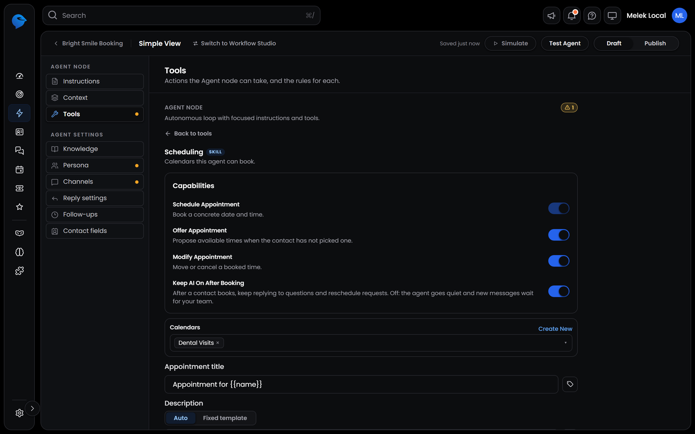

### **How do I connect my real calendar?**

Your agent always books into a Myna calendar. If your team already works from Google Calendar or HighLevel, link that calendar to your Myna calendar so every booking shows up there too, and so the agent never offers a time when you're already busy.

<Steps>
  <Step title="**Connect your calendar account**">
    In the sidebar, go to **Calendars** and open the **Connections** tab.

    - **Google Calendar:** select **Google Calendar** and sign in with your Google account. Myna then lists the calendars in that account.
    - **HighLevel:** select **LeadConnector**. Myna takes you to **Settings → Integrations**, where you connect your HighLevel sub-account. Its calendars then appear on the Connections tab.

    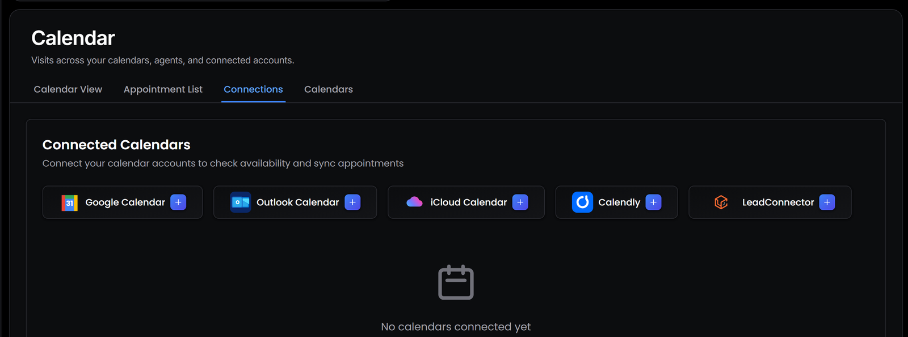

    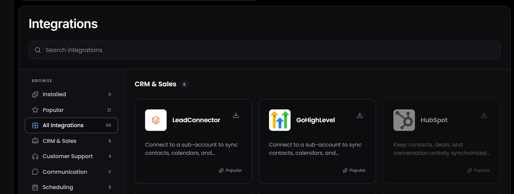
  </Step>
  <Step title="**Link it to your Myna calendar**">
    Open the **Calendars** tab and select your Myna calendar. We opened **Dental Visits**. Scroll down to the two calendar fields:

    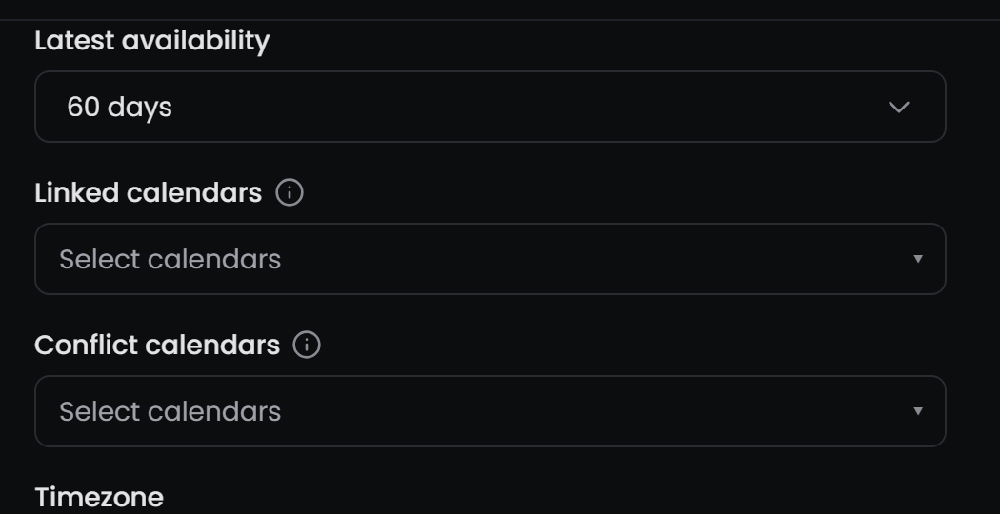

    <table>
      <colgroup>
        <col width="161" />
        <col width="513" />
      </colgroup>
      <thead>
        <tr>
          <th>**Field**</th>
          <th>**What it does**</th>
        </tr>
      </thead>
      <tbody>
        <tr>
          <td>**Linked calendars**</td>
          <td>Every appointment the agent books is also added to these calendars</td>
        </tr>
        <tr>
          <td>**Conflict calendars**</td>
          <td>Myna checks these calendars for busy times, so the agent never offers a time that's already taken</td>
        </tr>
      </tbody>
    </table>
  </Step>
  <Step title="**Save**">
    Select **Save**. From now on, the agent checks both calendars before it offers a time, and each booking appears in your own calendar as well as in Myna.
  </Step>
</Steps>

<Tip>
  Most teams pick the same calendar in both fields. That way bookings appear in the calendar you already use, and your own meetings block those times for the agent.
</Tip>

### **How do I set up the questions the agent asks?**

Qualifications are the questions your agent asks to collect the details you need. Select the pencil next to **Ask Qualification**, then select **Add Qualification**.

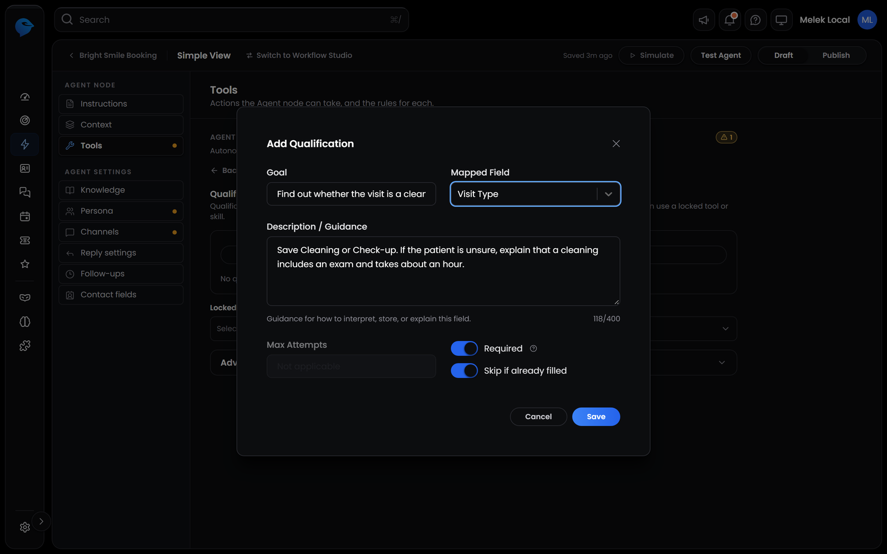

<table>
  <colgroup>
    <col width="196" />
    <col width="519" />
  </colgroup>
  <thead>
    <tr>
      <th>**Field**</th>
      <th>**What it's for**</th>
    </tr>
  </thead>
  <tbody>
    <tr>
      <td>**Goal**</td>
      <td>What the agent needs to find out, in plain words. The agent writes the question itself</td>
    </tr>
    <tr>
      <td>**Mapped Field**</td>
      <td>The contact field the answer is saved to. You can also select **Create custom field** to make a new one</td>
    </tr>
    <tr>
      <td>**Description / Guidance**</td>
      <td>How to read, save or explain the answer, up to 400 characters</td>
    </tr>
    <tr>
      <td>**Max Attempts**</td>
      <td>How many times the agent asks before moving on. It doesn't apply to required questions</td>
    </tr>
    <tr>
      <td>**Required**</td>
      <td>The agent must get an answer before it can use a locked tool</td>
    </tr>
    <tr>
      <td>**Skip if already filled**</td>
      <td>The agent doesn't ask if the contact record already has the answer</td>
    </tr>
  </tbody>
</table>

We added two required qualifications:

1. **Find out whether the visit is a cleaning or a check-up**, saved to a new custom field called **Visit Type**.
2. **Get the patient's email address**, saved to the **Email** field.

Then, under **Locked until qualified**, we selected **Offer Appointment** and **Schedule Appointment**. This means the agent can't offer or book a time until both questions are answered.

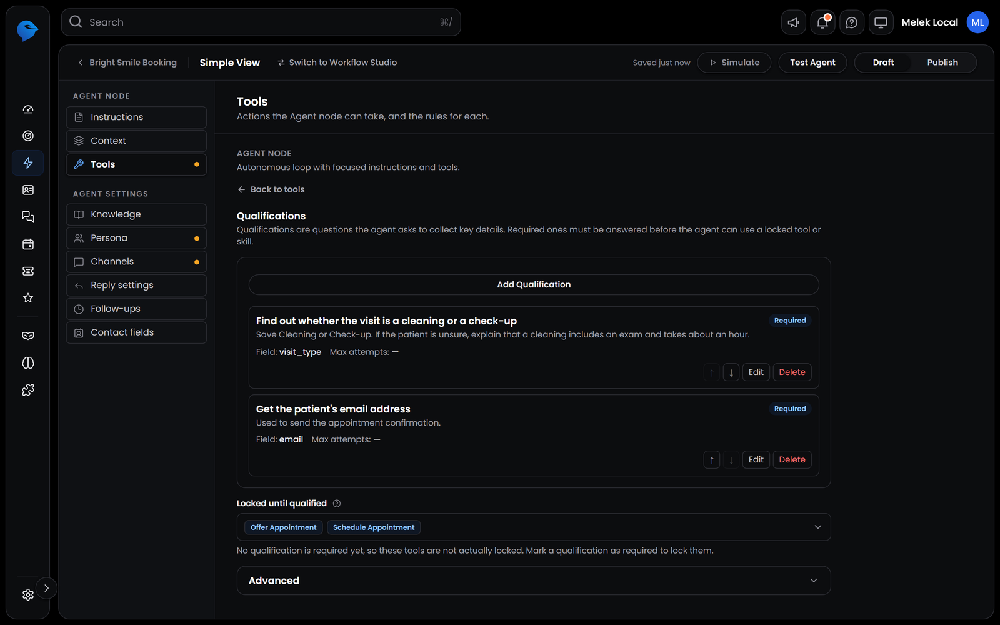

## **How do I write the node instructions?**

Node instructions tell the agent what its job is and how to handle the conversation. The agent reads them on every turn, so they shape everything it does.

Open **Instructions**. You can give the node a **Title**, then write the instructions below it. If you'd rather not start from a blank page, use **Or select an existing template** to load the instructions of one of Myna's ready-made templates and edit them.

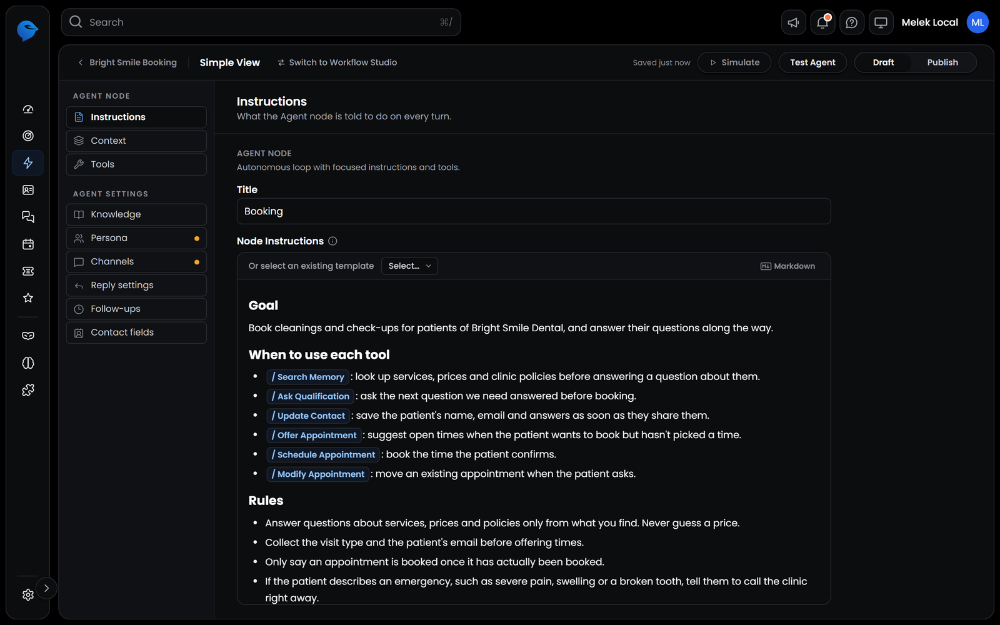

Good instructions usually have three parts: the **goal**, **when to use each tool**, and the **rules** the agent must follow. Here are the instructions we wrote for Bright Smile Dental:

```markdown Node instructions
# Goal
Book cleanings and check-ups for patients of Bright Smile Dental, and answer their questions along the way.

# When to use each tool
- /Search Memory: look up services, prices and clinic policies before answering a question about them.
- /Ask Qualification: ask the next question we need answered before booking.
- /Update Contact: save the patient's name, email and answers as soon as they share them.
- /Offer Appointment: suggest open times when the patient wants to book but hasn't picked a time.
- /Schedule Appointment: book the time the patient confirms.
- /Modify Appointment: move an existing appointment when the patient asks.

# Rules
- Answer questions about services, prices and policies only from what you find. Never guess a price.
- Collect the visit type and the patient's email before offering times.
- Only say an appointment is booked once it has actually been booked.
- If the patient describes an emergency, such as severe pain, swelling or a broken tooth, tell them to call the clinic right away.
```

The editor has three shortcuts:

<table>
  <colgroup>
    <col width="100" />
    <col width="611" />
  </colgroup>
  <thead>
    <tr>
      <th>**Type**</th>
      <th>**To**</th>
    </tr>
  </thead>
  <tbody>
    <tr>
      <td>`#`</td>
      <td>Add a heading</td>
    </tr>
    <tr>
      <td>`@`</td>
      <td>Insert a contact field, such as the customer's first name</td>
    </tr>
    <tr>
      <td>`/`</td>
      <td>Insert one of the agent's tools as a tool chip</td>
    </tr>
  </tbody>
</table>

<Tip>
  Keep instructions about the job: what to do, in what order, and what to avoid. Each tool already comes with its own rules for how it works, so you don't need to explain how to book an appointment, only when to do it.
</Tip>

## **What can the agent see?**

Open **Context** to see what the agent knows about the business, the customer and the conversation on every turn.

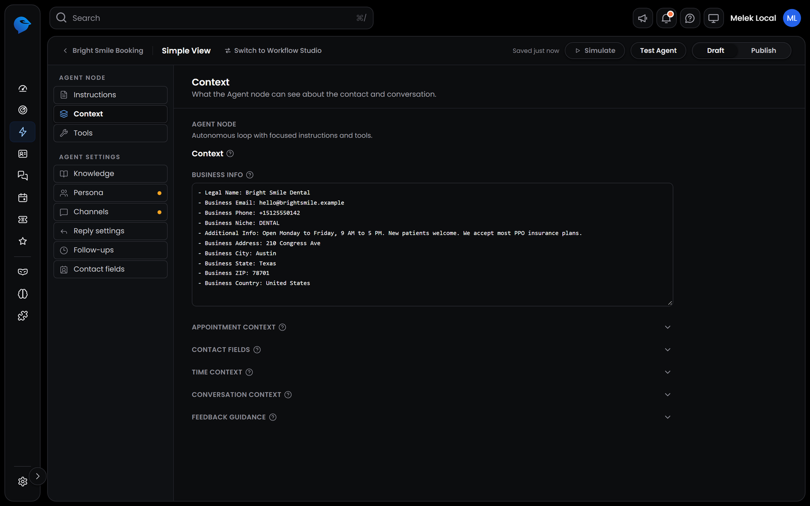

- **Business info:** filled in from your business profile. You can edit it here for this agent only.
- **Appointment context:** the customer's upcoming appointments.
- **Contact fields:** the details the agent can see about the customer.
- **Time context:** the current date and time in your time zone.
- **Conversation context:** the recent messages and a summary of the conversation.
- **Feedback guidance:** corrections you made while testing, covered in [Talk to your agent](/platform/getting-started/talk-to-your-agent).

You usually don't need to change anything here. It's a good place to check what your agent knows when it gives an answer you didn't expect.

## **Where does the agent get its knowledge?**

Open **Knowledge** to choose what the agent can search.

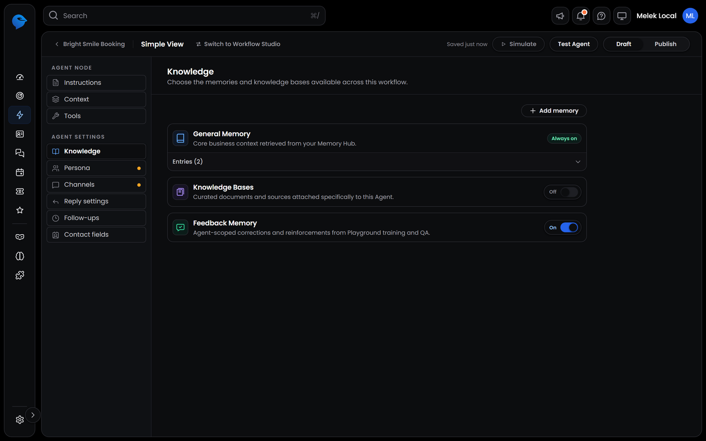

- **General Memory:** your workspace's shared knowledge in Memory Hub. Always on for every agent.
- **Knowledge Bases:** documents and sources for this agent only. Turn this on if the agent needs information your other agents don't.
- **Feedback Memory:** the corrections and examples you give the agent while testing. On by default.

Our booking agent only needs General Memory, where the clinic's services, prices and policies already are.

### **What's the difference between context and knowledge?**

Both give your agent information, but in different ways:

- **Context** is what the agent is always shown. Before every reply, Myna gives it the business info, the customer's details, the date and time, and the conversation so far. The agent doesn't have to do anything to get it.
- **Knowledge** is what the agent looks up when it needs it. Your Memory Hub is too large to read on every message, so the agent uses **Search Memory** when a question calls for it and only brings back the parts that match.

<table>
  <colgroup>
    <col width="158" />
    <col width="266" />
    <col width="284" />
  </colgroup>
  <thead>
    <tr>
      <th></th>
      <th>**Context**</th>
      <th>**Knowledge**</th>
    </tr>
  </thead>
  <tbody>
    <tr>
      <td>**How the agent gets it**</td>
      <td>Given automatically on every message</td>
      <td>Searched with Search Memory when needed</td>
    </tr>
    <tr>
      <td>**What it holds**</td>
      <td>Facts about your business, the customer and the conversation</td>
      <td>Your documents, FAQs, policies and website pages</td>
    </tr>
    <tr>
      <td>**Where you edit it**</td>
      <td>Business Profile and contact fields</td>
      <td>Memory Hub</td>
    </tr>
  </tbody>
</table>

In our test, a patient asked "Do you take insurance?" and the agent answered from **context**, because the clinic's business profile says it accepts most PPO plans. When she asked "How much is a cleaning?", the agent searched its **knowledge** and found the price in Memory Hub.

<Tip>
  Put short facts your agent should always know, such as your opening hours, address or payment options, in your business profile. Put longer information it should look up, such as price lists, policies and FAQs, in Memory Hub.
</Tip>

## **How do I give the agent a personality?**

Open **Persona**. A persona is the name and personality your agent speaks with. Choose **Select Existing** to reuse one, or **Create New** to make one.

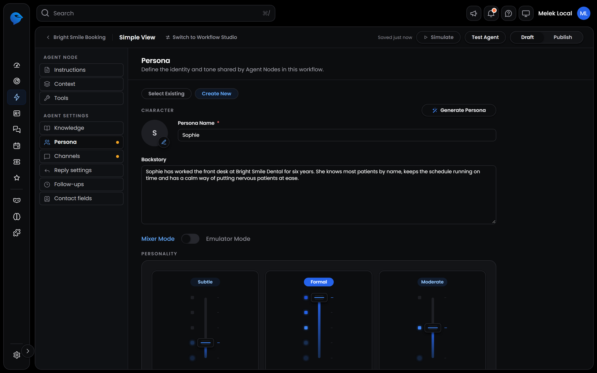

For our clinic, we created **Sophie**, who has worked the front desk at Bright Smile Dental for six years. A persona has:

- **Name, photo and backstory:** who the persona is. Select **Generate Persona** to have Myna write one from your business profile and Memory Hub.
- **Mixer Mode:** set six traits: humor, formality, empathy, creativity, enthusiasm and persuasiveness. You can also set writing style: spelling errors, slang, punctuation and emoji.
- **Emulator Mode:** paste examples of how your team writes, at least five messages, and Myna learns that voice instead.

Select **Create & Use Persona** to save it and use it on this agent.

<Warning>
  Personas are shared across your workspace. If you edit a persona that other agents use, the change applies to all of them straight away.
</Warning>

## **Where will the agent talk to customers?**

Open **Channels** to choose where the agent talks to customers.

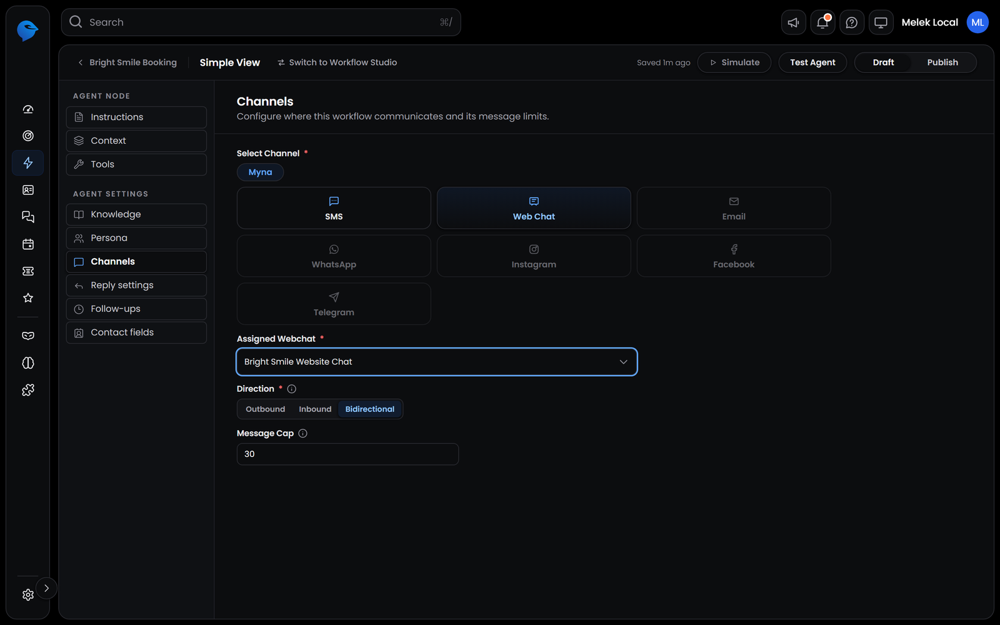

<table>
  <colgroup>
    <col width="127" />
    <col width="585" />
  </colgroup>
  <thead>
    <tr>
      <th>**Setting**</th>
      <th>**What it means**</th>
    </tr>
  </thead>
  <tbody>
    <tr>
      <td>**Channel**</td>
      <td>**SMS** needs a phone number from Phone System. **Web Chat** needs a chat widget from Settings → Webchats. WhatsApp, email, Facebook, Instagram and Google Business are available through a HighLevel connection</td>
    </tr>
    <tr>
      <td>**Direction**</td>
      <td>**Outbound**: the agent starts conversations. **Inbound**: it only replies. **Bidirectional**: both. The default is Bidirectional</td>
    </tr>
    <tr>
      <td>**Message Cap**</td>
      <td>The most messages the agent sends in one conversation. The default is 30</td>
    </tr>
  </tbody>
</table>

The clinic wants patients to chat from its website, so we chose **Web Chat** and selected the **Bright Smile Website Chat** widget.

### **How do I connect other channels?**

Each channel is set up once in your workspace. After that, any agent can use it.

<table>
  <colgroup>
    <col width="162" />
    <col width="325" />
    <col width="217" />
  </colgroup>
  <thead>
    <tr>
      <th>**Channel**</th>
      <th>**What you need**</th>
      <th>**Where to set it up**</th>
    </tr>
  </thead>
  <tbody>
    <tr>
      <td>**SMS**</td>
      <td>A phone number. Phone System is available on the Plus and Pro plans, and numbers in the US and Canada need a one-time business registration (A2P 10DLC)</td>
      <td>**Settings → Phone System**</td>
    </tr>
    <tr>
      <td>**Web Chat**</td>
      <td>A chat widget installed on your website</td>
      <td>**Settings → Webchats**</td>
    </tr>
    <tr>
      <td>**WhatsApp, email, Facebook, Instagram and Google Business**</td>
      <td>A HighLevel (LeadConnector) connection</td>
      <td>**Settings → Integrations**</td>
    </tr>
  </tbody>
</table>

#### **Web Chat**

<Steps>
  <Step title="**Create a widget**">
    Go to **Settings → Webchats** and select **New widget**. Give it a name and set how it looks under **Appearance** and **Behaviour**.
  </Step>
  <Step title="**Install it on your website**">
    Open the **Installation** tab and copy the code snippet. Paste it into your website's HTML before the closing `</body>` tag on every page where the chat should appear.

    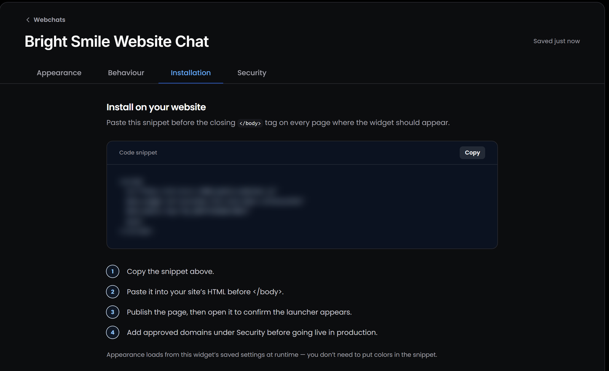
  </Step>
  <Step title="**Approve your domain**">
    Under **Security**, add your website's domain so the widget only works on your site.
  </Step>
  <Step title="**Assign it to your agent**">
    In the agent's **Channels**, select **Web Chat** and choose the widget under **Assigned Webchat**.
  </Step>
</Steps>

#### **WhatsApp, email and social channels**

These channels run through HighLevel, so you connect your HighLevel account first.

<Steps>
  <Step title="**Connect HighLevel**">
    Go to **Settings → Integrations**, select **LeadConnector** and connect your HighLevel sub-account.

    
  </Step>
  <Step title="**Choose the channel**">
    In the agent's **Channels**, a **LeadConnector** tab now appears next to **Myna**. Select it, then choose the channel you want the agent to use: SMS, email, Facebook, Google Business, Instagram or WhatsApp. For SMS and WhatsApp, also choose the number to send from.
  </Step>
</Steps>

<Note>
  An agent can use Myna's SMS and Web Chat at the same time. A HighLevel channel works on its own, so an agent that uses one can't use other channels as well.
</Note>

## **How should the agent reply?**

The last three sections work well with their default settings. Change them when you need to.

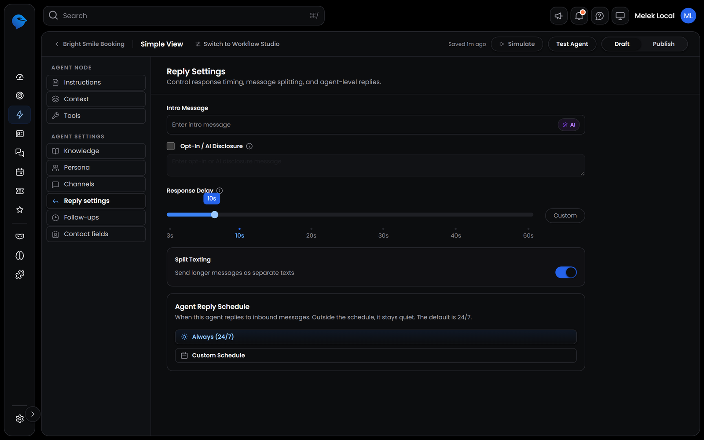

<table>
  <colgroup>
    <col width="131" />
    <col width="571" />
  </colgroup>
  <thead>
    <tr>
      <th>**Section**</th>
      <th>**What you can set**</th>
    </tr>
  </thead>
  <tbody>
    <tr>
      <td>**Reply settings**</td>
      <td>An **intro message** for conversations the agent starts, an **opt-in or AI disclosure** message, a **response delay** of 3 to 60 seconds (10 by default), **split texting** for long SMS replies, and the **agent reply schedule** (24/7 by default)</td>
    </tr>
    <tr>
      <td>**Follow-ups**</td>
      <td>Messages the agent sends when a customer stops replying, and how long it waits before the first one. The default wait is 24 hours</td>
    </tr>
    <tr>
      <td>**Contact fields**</td>
      <td>For each customer detail, whether the agent can see it, see and save it, or not use it at all</td>
    </tr>
  </tbody>
</table>

<Info>
  The response delay waits for the customer to finish typing. If they send several messages in a row, the agent answers them together.
</Info>

## **How do I put the agent live?**

Select **Publish** at the top right. Before anything goes live, Myna checks that the agent has everything it needs, such as a name, a persona and a channel, and that every follow-up and qualification is complete. If something is missing, nothing is published and Myna tells you what to fix.

Once it's published, the switch at the top shows **Published**.

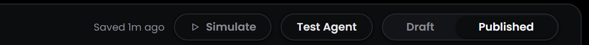

On the **Agents** page, the agent now shows as **Live**.

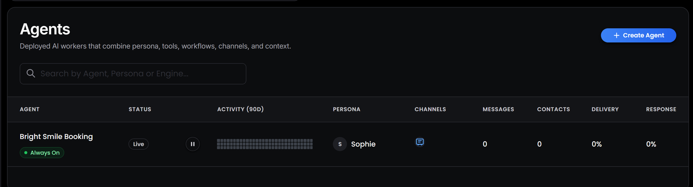

Here's the finished agent in Workflow Studio:

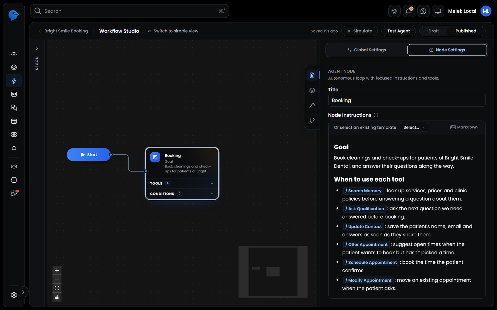

<Note>
  After publishing, your changes go to a new draft. Customers keep talking to the published version until you select **Publish** again. To stop the agent from replying for a while, set it to **Paused** on its page.
</Note>

## **Is there a faster way to start?**

Yes. Myna comes with ready-made templates, called **engines**, that set up the instructions, tools and rules for common jobs. You'll find them in Workflow Studio under **Global Settings → Engine**.

<Columns cols={3}>
  <Column>
    <Card title="**Schedule Appointments**" icon="calendar-check">
      Asks your questions, offers open times and books appointments. Booking stays locked until the required questions are answered, just like our example.
    </Card>
  </Column>
  <Column>
    <Card title="**Customer Service**" icon="headset">
      Answers from your knowledge, collects the details of each request, and opens and updates tickets for your team.
    </Card>
  </Column>
  <Column>
    <Card title="**Custom**" icon="diagram-project">
      Starts blank, so you set up the instructions and tools yourself, the way we did in this guide.
    </Card>
  </Column>
</Columns>

Pick an engine, add your own calendars, questions and persona, and your agent is ready to test. More engines, such as Collect Feedback and Collect Payment, are coming soon.

<Warning>
  You can switch engines while your agent is a draft. After the first publish, the engine is locked. If you change the agent's instructions or tools in Workflow Studio, it becomes a Custom agent.
</Warning>
