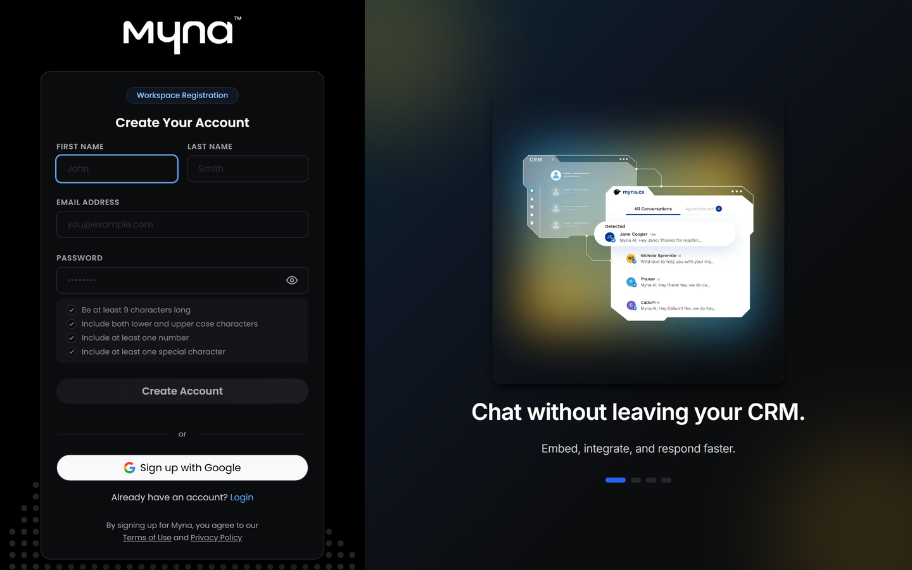
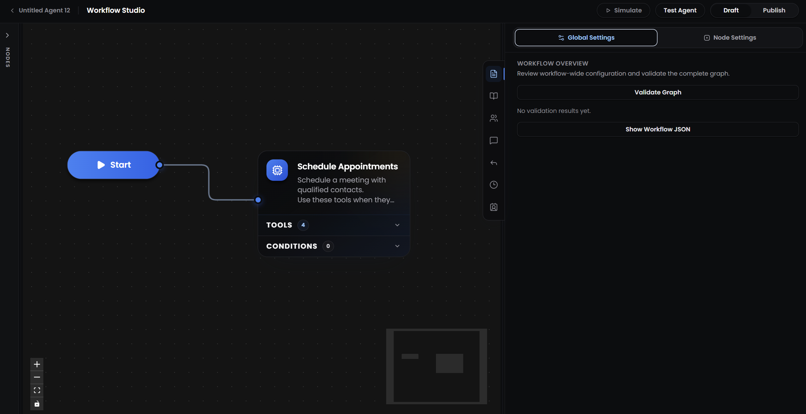
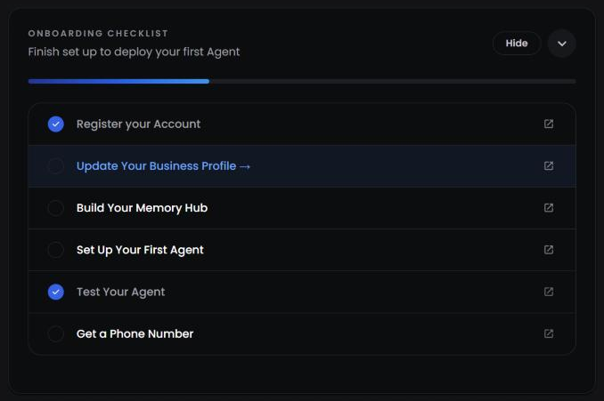
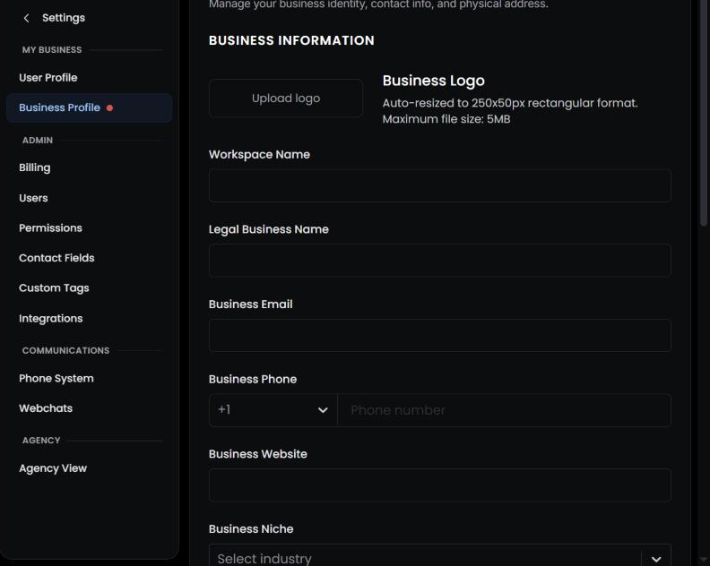
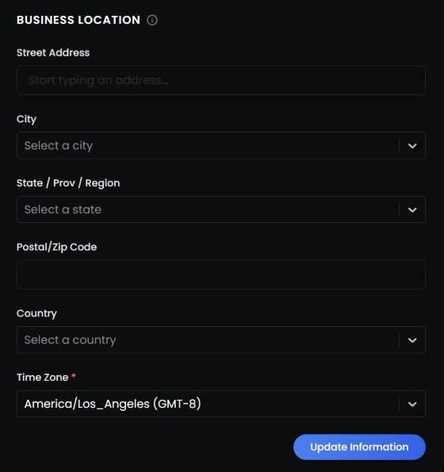
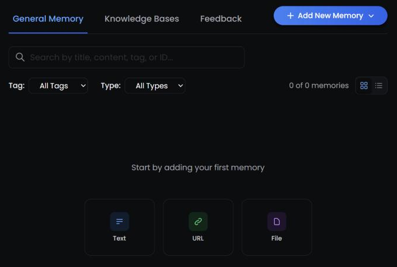

<Badge>Set up once for every agent</Badge> <Badge>Give your agents real context</Badge> <Badge>Bring your team in</Badge>

## **What is a workspace?**

A workspace is where everything your agents use lives. When you create a Myna account, Myna creates a workspace for you, and every agent you build inside it works from the same business details, knowledge, personas and customer records.

This is why setting up your workspace comes first. Before an agent replies to a customer, Myna gathers your business profile, your time zone, the contact's record and anything relevant from your Memory Hub, and gives all of it to the agent. A complete workspace means your agent has the facts it needs instead of guessing, and every new agent you build starts with that context already in place.

<Columns cols={2}>
  <Column>
    <Card title="**Business Profile**" icon="building">
      Your business name, contact details, address and time zone. Every agent reads it on every reply.
    </Card>

    <Card title="**Personas**" icon="id-badge">
      The names and personalities your agents speak with. One persona can be used by several agents.
    </Card>

    <Card title="**Channels**" icon="tower-broadcast">
      The phone numbers, web chat widgets and connected apps your agents use to reach customers.
    </Card>
  </Column>
  <Column>
    <Card title="**Memory Hub**" icon="brain">
      The knowledge your agents search to answer questions, built from your own text, files and website.
    </Card>

    <Card title="**Contacts and fields**" icon="address-book">
      The customer records your agents read and update, and the fields they are allowed to use.
    </Card>

    <Card title="**Team**" icon="users">
      The people who build your agents, follow conversations and step in when a customer needs a person.
    </Card>
  </Column>
</Columns>

<Tip>
  Workspaces don't share agents, contacts or knowledge. If you run more than one business or build agents for clients, give each one its own workspace so one business's details never appear in another's conversations. Agencies can manage several workspaces from one login with **Settings → Upgrade to Agency**.
</Tip>

## **How do I create my account?**

Creating an account takes a couple of minutes, and your workspace is created with it.

<Steps>
  <Step title="**Create your account**">
    Go to [app.myna.cx/register](https://app.myna.cx/register) and enter your first name, last name, email address and a password. Your password needs at least 9 characters, upper and lower case letters, a number and a special character.

    You can also select **Sign up with Google** to use your Google account instead of a password.

    
  </Step>
  <Step title="**Verify your email**">
    Myna sends a 6-digit code to your email address. Enter it on the **Check your email** screen to confirm the address belongs to you.

    If the code doesn't arrive, select **Resend code**. If you typed the wrong address, select **Wrong email? Change it** and correct it before you verify.
  </Step>
  <Step title="**Tell Myna about your business**">
    A short form asks for a few details. All of them are optional, and you can skip the form and fill them in later.

    - **Company name:** saved as your workspace name and in your business profile.
    - **Industry:** the kind of business you run, such as dental, real estate or home services.
    - **What you want to use Myna for:** for example customer support, appointment scheduling or building agents for clients.
    - **Where you heard about Myna**

    When you finish, Myna opens an empty project in **Workflow Studio**, so you can start building and testing your first agent right away.

    
  </Step>
</Steps>

<Note>
  Next time you sign in, you can use your password, your Google account or **Continue with email code**, which sends a one-time sign-in code to your email.
</Note>

## **What should I set up before building my first agent?**

Your first project in Workflow Studio is a good place to try things out and see how an agent responds. However, before you build the agent you will actually deploy to customers, it is worth setting up a few things in your workspace. Every agent you build relies on them, so a little time here makes each one more accurate and ready to work from its very first conversation:

- **Business profile:** so your agent knows who you are, where you are and what time it is for you.
- **Memory Hub:** so it can answer customers' questions from your own content.
- **Contact fields:** so it has somewhere to save what customers tell it.
- **Channels:** so it is ready to reach customers as soon as you publish it.
- **Your team:** so the right people can follow conversations and step in when needed.

The sections below walk you through each one.

At the top of your Dashboard, the **Onboarding Checklist** follows your progress. Select the arrow to open it. Items are checked off automatically as you complete them, so you always know what is left.

| **Checklist item** | **Where you do it** |
| --- | --- |
| **Register your Account** | Done when you sign up |
| **Update Your Business Profile** | Settings → Business Profile |
| **Build Your Memory Hub** | Memory Hub |
| **Set Up Your First Agent** | Agents |
| **Test Your Agent** | Playground |
| **Get a Phone Number** | Settings → Phone System |

Building and publishing your deployable agent is covered in [Launch your first agent](/platform/getting-started/launch-your-first-agent).

## **Why does my agent need a business profile?**

Your business profile is the one piece of information every agent in your workspace sees on every single reply. Your agent doesn't need to search for it, so when a customer asks where you are, how to reach you or what you do, the answer is already in front of it.

Open **Settings → Business Profile**, fill in the following and select **Update Information** to save:

| **Field** | **How your agent uses it** |
| --- | --- |
| **Legal business name** | The name your agent uses when it talks about your business |
| **Business email and phone** | Contact details your agent can share when a customer asks |
| **Business niche** | Tells your agent what kind of business it represents |
| **Additional info** | Anything else your agent should always know, such as opening hours, service area or payment options |
| **Business location** | Lets your agent tell customers where to find you |
| **Time zone** (required) | Your agent's clock. It decides what "today", "tomorrow" and "this afternoon" mean in a conversation |
| **Workspace name, logo and website** | Shown in the app. Your agent doesn't read these, so to teach it what is on your website, import the site into Memory Hub |

<Warning>
  The time zone starts as **America/Los_Angeles**. Change it to your own before your agent talks to anyone. If it is wrong, your agent will read dates and times in the wrong time zone, which affects every appointment it discusses.
</Warning>

<Tip>
  Keep **Additional info** to short facts that rarely change. Longer content such as FAQs, policies and price lists belongs in Memory Hub, where your agent can search it.
</Tip>

## **What should I add to Memory Hub first?**

Memory Hub holds everything your agents know about your business beyond the business profile. Start with **General Memory**: it belongs to the whole workspace, and every agent searches it when it needs to look something up. Later, when you build an agent, you can give it its own knowledge base for things only that agent needs.

Your agent searches Memory Hub by meaning, so it can find the right passage even when a customer words the question differently from how you wrote it. It can only answer reliably from what you give it, though, which is why it is worth filling Memory Hub before your agent goes live.

Open **Memory Hub**, stay on the **General Memory** tab and select **Add New Memory**. There are three ways to add knowledge:

<Columns cols={3}>
  <Column>
    <Card title="**Text**" icon="pen">
      Type it in yourself, or start from a template: **Free Text**, **FAQ**, **Objection / Rebuttal** or **Word & Phrase Rules**.
    </Card>
  </Column>
  <Column>
    <Card title="**URL**" icon="globe">
      Enter your website's address. Myna finds your pages, selects the key ones and imports them in the background.
    </Card>
  </Column>
  <Column>
    <Card title="**File**" icon="file-arrow-up">
      Upload PDF, Word, text, CSV and Excel files, or images. Myna reads the text from images too.
    </Card>
  </Column>
</Columns>

A good first round usually covers:

- **Services and prices:** what you offer, what it costs and who it is for.
- **Policies:** cancellations, refunds, warranties and anything else customers ask about before they commit.
- **Common questions:** the questions your team answers every week, written as an FAQ.
- **Words to use or avoid:** your preferred terms, product names and phrases you never want your agent to say, added as **Word & Phrase Rules**.

<Note>
  A website import is a snapshot of your site at the time you import it. When your website changes, import the updated pages again. For spreadsheets, Myna reads the first 50 rows, so split longer sheets into several files.
</Note>

## **Which customer details can my agents use?**

Every contact in Myna has a record with standard fields such as name, phone number and email. In **Settings → Contact Fields** you can add your own fields for the details your business collects, such as service type, budget or preferred location. Fields can be text, numbers, currency, dates, dropdowns, checkboxes and more.

It is worth creating these fields before you build your agent. When your agent asks customers questions, it saves each answer to a contact field, so the field needs to exist first. Each agent then has its own setting for which fields it can see and which it can edit, and every new agent starts from your workspace default.

You can also create **Custom Tags** in **Settings → Custom Tags** to group and filter your contacts.

## **How will my agent reach customers?**

An agent needs at least one channel before it can talk to real customers. You'll choose which channels each agent uses when you build it, but setting them up now means they are ready when you are. You'll find them in **Settings**, under **Communications** and **Integrations**.

<Columns cols={3}>
  <Column>
    <Card title="**Phone System**" icon="phone">
      Get a phone number so your agent can send and receive SMS. Each number belongs to one agent.
    </Card>
  </Column>
  <Column>
    <Card title="**Webchats**" icon="comments">
      Create a chat widget and add it to your website by pasting a short script.
    </Card>
  </Column>
  <Column>
    <Card title="**Integrations**" icon="plug">
      Connect HighLevel to use your agent on WhatsApp, email, Facebook, Instagram and Google Business, and Google Calendar to book appointments.
    </Card>
  </Column>
</Columns>

<Note>
  Phone numbers in the US and Canada need a one-time business registration (A2P 10DLC) before you can use them. US carriers require it for business texting, and Myna guides you through it in **Phone System**.
</Note>

<Info>
  You don't need a channel to start building. You can create an agent and test it in Playground before any channel is connected.
</Info>

## **Who on my team can do what?**

Most businesses have people who build agents and people who follow conversations and take over when a customer needs a human. Roles let each of them see what they need.

To invite someone, open **Settings → Users**, select **Add user**, enter their email address and choose a role. They receive an email and set their own name and password when they join.

| **Role** | **What they can do** |
| --- | --- |
| **Owner** | Everything, including managing billing and deciding what each role is allowed to do |
| **Admin** | Build and edit agents, personas and Memory Hub, use Playground, manage integrations, and work with contacts, conversations and calendars |
| **User** | View the dashboard, view and update contacts, read and reply to conversations, and view calendars |

Building and changing agents needs the Admin role, so give it to anyone who will work on your agents. The User role suits teammates who handle conversations day to day. Owners can change what each role can do in **Settings → Permissions**.

## **What about billing?**

Myna runs on a credit balance, which you can see and top up in **Settings → Billing**. Text messages and Playground tests use credits, so check your balance before you start testing. Your plan also sets how many agents you can create: Starter includes 2, and Pro and Agency plans have no limit.
