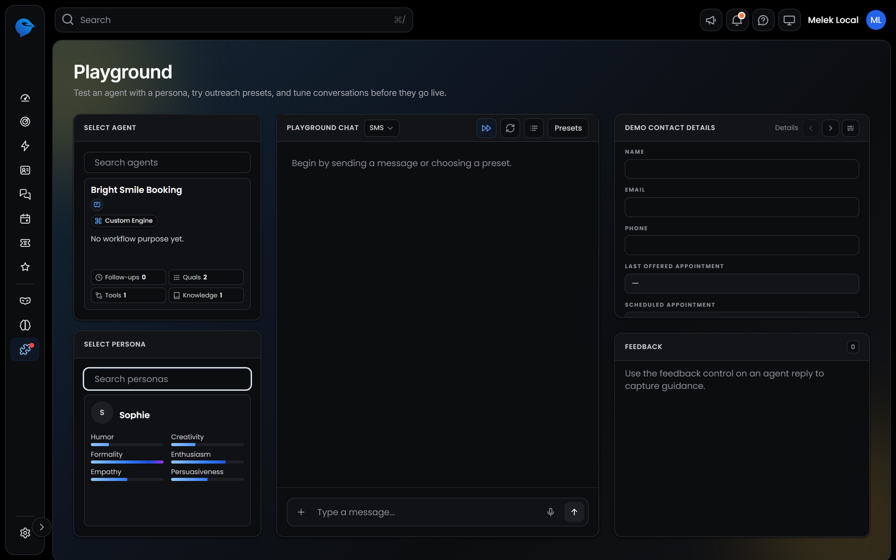
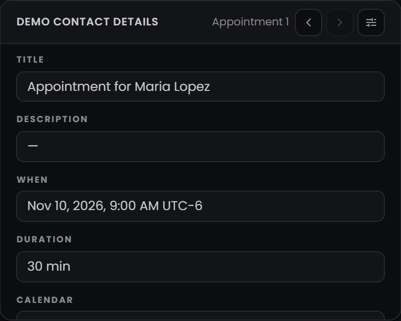
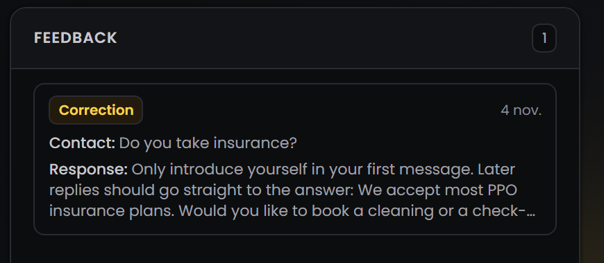
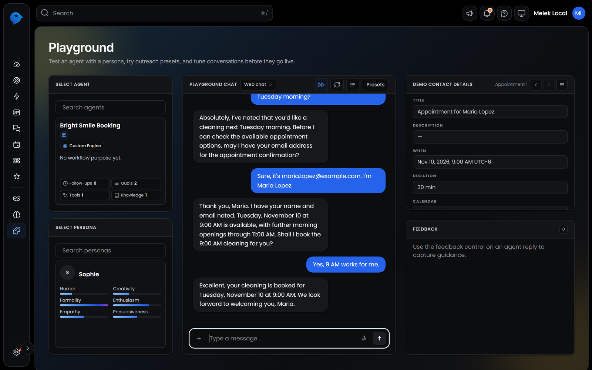
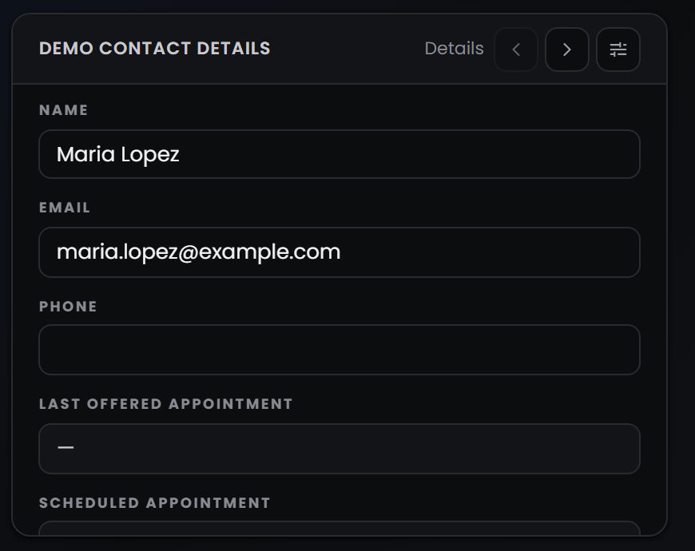
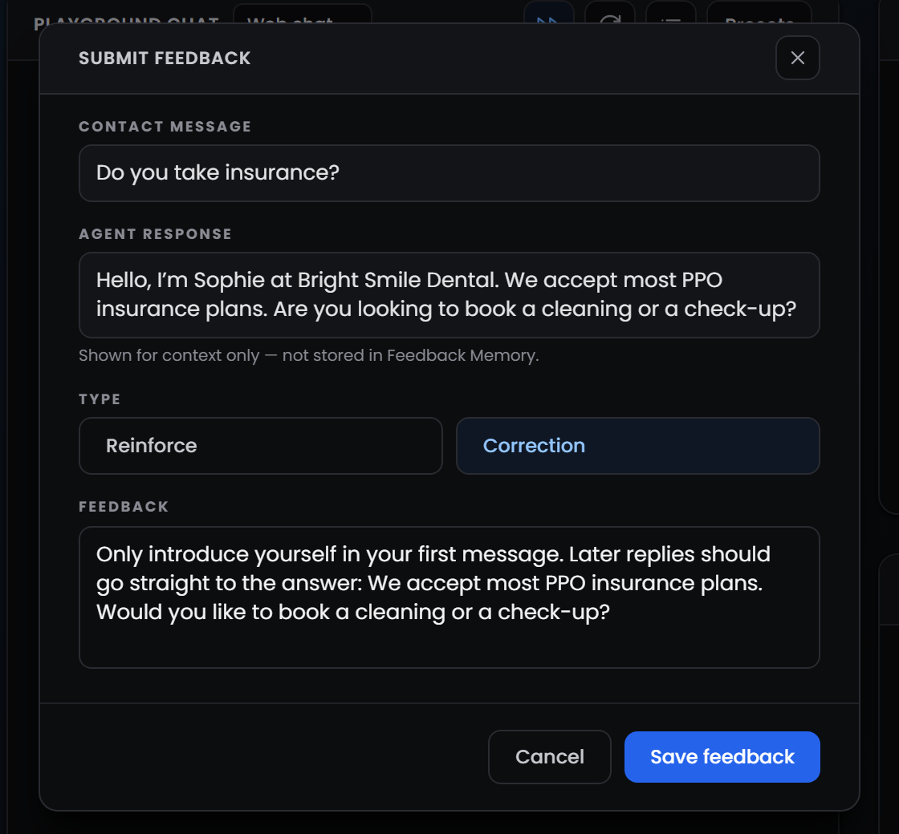

<Badge>Test before customers do</Badge> <Badge>Runs your latest draft</Badge> <Badge>Teach it with feedback</Badge>

## **Why test your agent?**

Now that we've built an agent, it's time to talk to it. The **Playground** is a private chat where you play the customer and your agent replies exactly as it would on a real channel. It answers from your knowledge, asks your questions, saves details and books appointments, so you can see how it behaves before anyone else does.

The Playground always runs your **latest draft**. You can change something in Workflow Studio, switch to the Playground and see the difference straight away, without publishing.

<Note>
  Each message you send in the Playground uses credits from your balance, just like a real conversation.
</Note>

## **How do I open the Playground?**

There are two ways:

- **From your agent:** select **Test Agent** at the top of Workflow Studio or on the agent's page. The Playground opens in a new tab with that agent already selected.
- **From the sidebar:** select **Playground**, then choose any agent you've built.

## **What's on the Playground screen?**

The Playground has four panels.

### **Select Agent**

Search for an agent and select it. Each agent card shows its channels, its engine and how many follow-ups, qualifications, tools and knowledge sources it has, so you can check you're testing the right one.

### **Select Persona**

Choose the persona the agent speaks with. Its traits show under its name. You can test the same agent with a different persona to compare how each one sounds, without changing the agent.

### **Playground Chat**

This is where you talk to the agent. Type a message at the bottom and send it. At the top of the chat:

<table>
  <colgroup>
    <col width="168" />
    <col width="526" />
  </colgroup>
  <thead>
    <tr>
      <th>**Control**</th>
      <th>**What it does**</th>
    </tr>
  </thead>
  <tbody>
    <tr>
      <td>**Channel**</td>
      <td>The menu next to **Playground Chat**. Choose **SMS**, **Web chat** or **Email**. The agent shapes its replies for the channel you pick, so test on the channel your customers will use</td>
    </tr>
    <tr>
      <td><Icon icon="forward" /> **Rapid response**</td>
      <td>On by default, so the agent replies straight away. Select it to add a 7-second delay before each reply, closer to a real conversation</td>
    </tr>
    <tr>
      <td><Icon icon="arrows-rotate" /> **Reset conversation**</td>
      <td>Starts a new conversation and deletes the demo contact and everything the agent created for it, such as saved details and bookings</td>
    </tr>
    <tr>
      <td><Icon icon="list" /> **Logs**</td>
      <td>**Coming soon.** Will show what the agent did behind each reply, such as the tools it used</td>
    </tr>
    <tr>
      <td>**Presets**</td>
      <td>Sends the intro and follow-up messages you set up for the agent, so you can see how they read. It's greyed out if the agent has none</td>
    </tr>
  </tbody>
</table>

### **Demo Contact Details**

While you chat, you play a **demo contact**. This panel shows what the agent saves about you as the conversation goes on. Use the arrows to move between views:

- **Details:** name, email, phone, the last appointment offered and the scheduled appointment.
- **Appointment:** the booking the agent made, with its time, duration and location.
- **Tickets:** any ticket the agent opened.
- **Custom:** the custom fields the agent filled in, such as Visit Type in our example.

<Info>
  Everything the agent does in the Playground really happens on the demo contact: fields are saved and appointments are booked. Playground bookings stay on your calendar until you reset the conversation.
</Info>

### **Feedback**

Lists the corrections and examples you've given this agent. More on this below.

## **What does a test conversation look like?**

Here's a short conversation with our Bright Smile Dental booking agent, where we play a new patient called Maria:

Each reply shows a different part of the agent at work:

<Steps>
  <Step title="**Maria asks about prices**">
    She asks how much a cleaning costs. The agent searches Memory Hub, answers with the clinic's real price, and asks whether she wants a cleaning or a check-up.
  </Step>
  <Step title="**Maria asks to book**">
    She asks for a cleaning next Tuesday morning. The agent saves the visit type, but before it checks the calendar, it asks for her email. Booking is locked until every required question is answered.
  </Step>
  <Step title="**Maria shares her details**">
    The agent saves her name and email to the contact record, then offers the first open time on Tuesday morning.
  </Step>
  <Step title="**Maria confirms**">
    The agent books the appointment on the Dental Visits calendar and only then confirms it to her.
  </Step>
</Steps>

Then check the **Demo Contact Details** panel to see what the agent saved:

## **How do I correct the agent?**

When a reply isn't quite right, or is exactly right, tell the agent. Hover over any reply and select:

- **👍 Reinforce:** this reply is good. Keep answering like this.
- **👎 Correction:** this reply should be different. Write the reply you'd prefer.

In our test, Sophie introduced herself again in the middle of the conversation. We selected **Correction** and wrote how she should answer instead:

Select **Save feedback**. The correction is saved to the agent's **Feedback Memory** and shows in the **Feedback** panel.

From then on, when a customer sends a similar message, the agent uses your feedback to shape its reply, in the Playground and in real conversations. Feedback belongs to the agent you gave it to, and you can review or delete it anytime in **Memory Hub → Feedback**.

<Tip>
  Feedback is for small fixes in how the agent answers. If the agent keeps doing the wrong thing, such as booking too early or using the wrong tool, change its instructions or tools instead.
</Tip>

## **What should I test before going live?**

Before you share your agent with customers, run through a few conversations like these:

- **Common questions:** ask what customers ask every week and check the answers match your knowledge.
- **Something it can't know:** ask about something that isn't in your knowledge and make sure it doesn't make up an answer.
- **The full job:** go through the whole task, such as booking, rescheduling or opening a ticket, from first message to confirmation.
- **Required questions:** try to skip them and check the agent still asks before it acts.
- **Your rules:** test the situations your instructions mention, such as an emergency or a request for a person.
- **Each channel:** switch between SMS and Web chat and check the replies read well on both.

Select **Reset conversation** between tests to start fresh.
